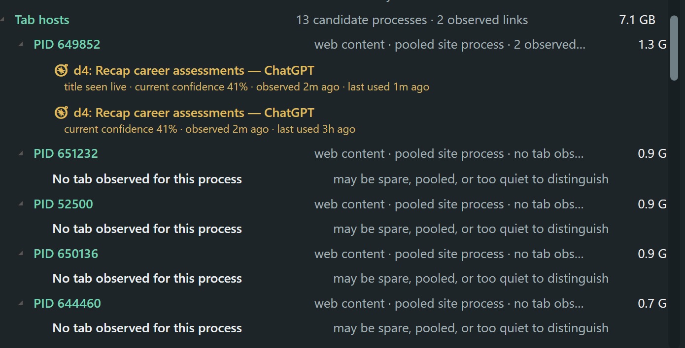
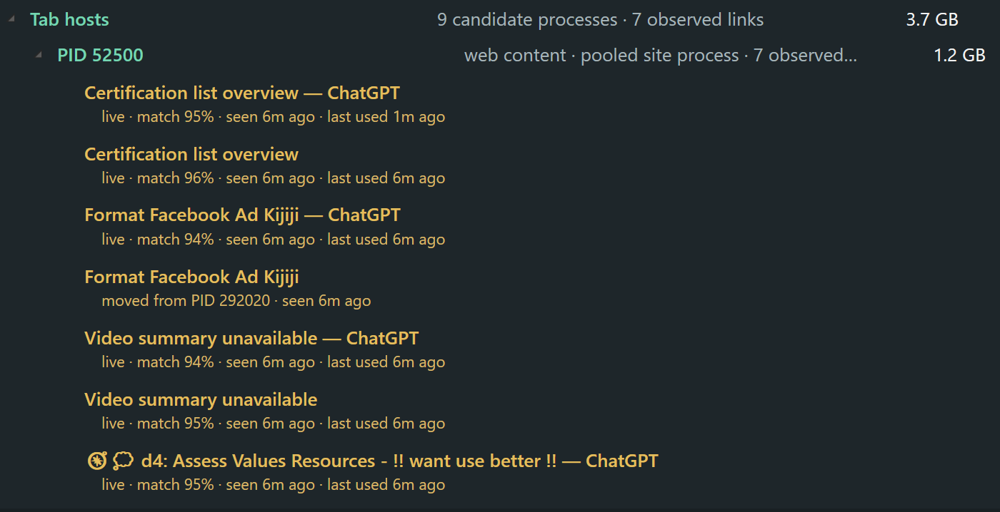

# Memory Bloom progress record

This is the human-readable design trail. Every feature or design prompt should add a dated iteration, save new screenshots under `docs/screenshots/<version>/`, update **Current state** and **Next state**, and end with a Git commit.

## Current state — 0.8.0

- Conditional pressure widget with proportional opacity/color intensity; hovering anywhere over the window temporarily makes it fully opaque.
- Compact and detailed modes with click-versus-drag handling, native Windows move/resize styles, standard edge Snap/maximize previews, and monitor-aware expansion toward the available half of the screen.
- Branded executable/window/tray icon, Alt+Tab presence, desktop shortcut, and best-effort Windows shell pinning across virtual desktops.
- Stable collapsible process hierarchy and process actions.
- Firefox's active title is observed live and a 250 ms lightweight sampler accumulates/decays process activity evidence, reducing typical active-tab matching from tens of seconds to the first distinguishable burst.
- An optional local Firefox companion now supplies the authoritative open-tab catalog, stable IDs, last-access time, and tab lifecycle/reload timing. Its native bridge makes no network requests.
- Companion loading/reload events open a short background-aware correlation window; Firefox still does not expose OS content-process PIDs, so final PID binding remains honest inference rather than a fabricated claim.
- Firefox rows now distinguish candidate tab-host processes from observed tab links. Pooled processes are no longer described as proof of one or more tabs, and built-in Firefox page processes participate in matching.
- Firefox titles are placed beneath inferred tab-host processes when activity separates one candidate; unmatched titles remain in an explicit unresolved section. PID placement stops being current after two minutes without fresh evidence, but stays beneath its last live PID as yellow historical evidence instead of disappearing.
- Recovery/live echoes with the same normalized title are collapsed when stable tab IDs are unavailable; companion-supplied same-title tabs remain distinct.
- Live title changes are tracked per Firefox window, so a single-page app such as ChatGPT replaces its prior synthetic title instead of accumulating each visited view as another tab. A newer Firefox snapshot decides whether a transition was navigation or a real tab switch.
- Restart detection clears old activity evidence, and a recovery snapshot older than the current Firefox session is suppressed instead of resurfacing closed pre-restart titles.
- Per-tab confidence, observation age, recent process drift, and stale/uncertain yellow warnings make the probabilistic mapping visible rather than pretending it is exact.
- Firefox process rows retain their own expanded/collapsed state, and tab titles use a full-width first line with an indented age/status line.
- Estimated Windows/cache/kernel/shared-memory reconciliation group.
- App groups and their child PIDs—including Firefox tab hosts—sort by private memory descending, while memory figures step right with hierarchy and remain clear of the scrollbar.
- Dark process context menus and scrollbar, with wider wrapping tooltips that reveal the complete explanation.
- One DPI-scaled native region follows the panel's 22-DIP curve, removing the competing second corner while retaining Windows resize/Snap behavior.
- Passive development restarts preserve the user's foreground window and avoid a flashing taskbar request for attention.

Screenshots:

- [Overall accounting 0.8.0](docs/screenshots/v0.8.0/detailed.png)
- [Firefox host status 0.8.0](docs/screenshots/v0.8.0/firefox-processes.png)
- [Unresolved catalog 0.8.0](docs/screenshots/v0.8.0/firefox-tabs.png)
- [Compact 0.8.0](docs/screenshots/v0.8.0/minimal.png)

## Next state — 0.9.0

- Load the companion in Firefox after explicit installation confirmation, validate full catalog/event delivery against ordinary browsing, then pursue Mozilla signing for persistence across Firefox restarts.
- Tune event-to-process correlation using real reload/navigation cases, especially several background tabs refreshed close together.
- Add direct tab activation/closing once the companion's live catalog has been validated.
- Consider persisting recent inferred associations across app restarts with a short expiry.

## Iterations

### 0.8.0 — Authoritative tab awareness and durable historical evidence

Last state: Firefox's recovery file could lag several minutes, foreground-title observation could not see background refreshes at all, same-title recovery/live entries could appear twice, and a two-minute-old PID link vanished from its process even though the underlying evidence still had explanatory value.

Reported ground truth: the Firefox dropdown showed Gmail, Calendar, several ChatGPT tabs, ActivityWatch, and New Tab open at once.

Reported Bloom result: only two duplicate links were observed under one PID while eleven other candidate processes showed no tab. This is the expected failure mode of polling the delayed recovery file and correlating only a foreground window title; refreshing a background tab does not put its title in the native top-level window caption.

Result: expired PID claims remain visible but unmistakably historical; current and historical counts are separate; fallback snapshot echoes are deduplicated; sampling runs every 250 ms; and the optional companion/native host now provides the full live catalog and event timing needed to know every open tab promptly. The extension provides tab identity, not an OS PID, so Bloom still infers the final mapping from measured process activity.

Next state: install/load the companion with explicit confirmation, compare its live catalog to the Firefox dropdown, and tune simultaneous background-refresh inference before seeking Mozilla signing.

### 0.7.0 — Edge-aware expansion and expiring Firefox evidence

Last state: reopening a development build could steal focus and leave its taskbar button flashing; a DPI mismatch plus DWM rounding produced a second corner outside the panel's curve; a right-aligned compact view expanded off the monitor; and live Firefox title changes accumulated for 12 hours while a six-minute-old association continued to advertise its original 95% confidence.

Reported corner context: this user-supplied crop shows the narrow outer native curve competing with the broader inner panel curve. The broader 22-DIP panel curve is now the sole geometry and is converted to physical pixels for the active monitor DPI.

Reported Firefox context: this user-supplied view shows one ChatGPT tab's changing document titles accumulated as seven links under one PID, plus six-minute-old observations retaining 94–96% labels. It motivated per-window title replacement, ChatGPT suffix normalization, confidence aging, and a two-minute placement expiry.

Result: the compact view records which half of its current monitor it occupies and detailed mode grows inward while preserving the near edge; collapsing restores the compact position. App child PIDs sort by memory. Firefox live titles are tracked per window, same-page transitions suppress superseded titles until the next recovery snapshot distinguishes navigation from a tab switch, and unrefreshed PID evidence moves to **Unresolved tabs** after two minutes. Project restarts can deploy and show passively while restoring the previously focused window.

Next state: observe tab switches versus same-tab navigation across several Firefox windows and adjust the two-minute lifetime only if real browsing shows it is too aggressive.

### 0.6.0 — Honest Firefox host status and visual polish

Last state: Firefox's pooled `tab` processes were described as “one or more tabs,” stale titles could remain after a browser restart, tooltips could run out of their narrow surface, opacity did not react to hover, and the rounded inner panel exposed opaque square window corners.

Reported context: this user-supplied 0.5.0 screenshot was taken after Firefox had been restarted with a much smaller live session. It records the misleading five-process/zero-match wording and the lingering unresolved snapshot that motivated this pass; it is diagnostic evidence, not a release beauty shot.

Result: candidate Firefox tab-host processes are now explicitly separated from observed tab links, built-in Firefox pages can be sampled, restart/session timestamps discard genuinely pre-restart data, and idle/spare candidates say “no tab observed” instead of claiming ownership. Hover raises the window to full opacity, wrapped tooltips show their full text, and a native rounded region removes the square outer corners without giving up normal Windows Snap.

Next state: evaluate the new wording and matching during ordinary browsing, then decide whether an optional extension is worth adding for event-driven tab identity and actions.

### 0.5.0 — Native Windows integration and faster Firefox evidence

Last state: custom coordinate dragging bypassed Windows Snap, the app was absent from Alt+Tab and only lived on one virtual desktop, active Firefox inference sampled only during the six-second heavy refresh, and all memory values ended on a single aligned edge.

Result: the Windows non-client move loop now supplies standard Snap/maximize feedback; native resize/maximize styles are verified; the branded app is visible in Alt+Tab, pinned across virtual desktops, and installable from a desktop shortcut. Live Firefox titles appear without waiting for the recovery file, and a 500 ms rolling activity sampler can associate an active title after the first clear burst. Hierarchical memory indentation is restored.

Next state: measure ambiguous/static Firefox pages in daily use and decide whether an optional signed companion is worth maintaining for stable tab IDs and direct tab controls.

### 0.4.0 — Per-process Firefox tabs and visual history

Last state: Firefox tab titles were segregated in one section, nested row widths drifted toward the scrollbar, and no durable screenshot/commit workflow existed.

Result: confident title matches now appear beneath their inferred Firefox web-content PID, unresolved titles remain honest and visible, changed/stale mappings are yellow, title metadata is split onto an indented second line, memory values share a clean right edge, and each feature prompt now produces screenshots, progress notes, a release snapshot, and a Git commit.

Next state: validate inference during normal browsing and decide whether the extra certainty and tab controls of an optional companion extension are worth the installation cost.

### 0.3.0 — Firefox metadata and system-memory accounting

Last state: process roles existed, but Firefox titles were only available through `about:processes`; system memory outside app rows was unexplained.

Result: local Firefox recovery data supplies title/age snapshots; non-process RAM is grouped into an explained estimate; refresh and dark-theme details were refined.

Next state: associate titles with processes probabilistically without representing the result as authoritative.

### 0.2.0 — Process interaction pass

Last state: the compact view opened details, but title-bar dragging and clicking were not differentiated; refresh forced Firefox open.

Result: click toggles, movement drags, double-click focuses, context actions were added, and expansion state became persistent.

Next state: improve Firefox tab-level context and account for system memory.

### 0.1.0 — Initial application

Last state: earlier standalone memory dashboards and scripts existed, but no conditional translucent companion.

Result: Memory Bloom introduced threshold-driven visibility, intensity graphics/transparency, compact scaling, process investigation, tray access, and startup.

Screenshots:

- [Detailed 0.1.0](docs/screenshots/v0.1.0/detailed.png)
- [Minimal 0.1.0](docs/screenshots/v0.1.0/minimal.png)

Next state: improve direct manipulation and Firefox process descriptions.

## Visual archive

Every generated checkpoint below is retained and linked here. Version 0.2.0 predates the automated capture workflow and has a [reconstructed functional record](docs/history/v0.2.0.md) rather than screenshots.

- 0.1.0: [detailed](docs/screenshots/v0.1.0/detailed.png), [minimal](docs/screenshots/v0.1.0/minimal.png)
- 0.3.0: [detailed](docs/screenshots/v0.3.0/detailed.png), [minimal](docs/screenshots/v0.3.0/minimal.png)
- 0.4.0: [detailed](docs/screenshots/v0.4.0/detailed.png), [Firefox processes](docs/screenshots/v0.4.0/firefox-processes.png), [Firefox tabs](docs/screenshots/v0.4.0/firefox-tabs.png), [minimal](docs/screenshots/v0.4.0/minimal.png)
- 0.5.0: [detailed](docs/screenshots/v0.5.0/detailed.png), [Firefox processes](docs/screenshots/v0.5.0/firefox-processes.png), [Firefox tabs](docs/screenshots/v0.5.0/firefox-tabs.png), [minimal](docs/screenshots/v0.5.0/minimal.png), [icon](docs/screenshots/v0.5.0/icon.png)
- 0.6.0: [reported context](docs/screenshots/v0.6.0/reported-before-firefox-restart.png), [detailed](docs/screenshots/v0.6.0/detailed.png), [Firefox candidate hosts](docs/screenshots/v0.6.0/firefox-processes.png), [Firefox tabs](docs/screenshots/v0.6.0/firefox-tabs.png), [minimal](docs/screenshots/v0.6.0/minimal.png)
- 0.7.0: [reported corner context](docs/screenshots/v0.7.0/reported-before-double-corners.png), [reported Firefox context](docs/screenshots/v0.7.0/reported-before-stale-tab-links.png), [detailed](docs/screenshots/v0.7.0/detailed.png), [memory-sorted Firefox hosts](docs/screenshots/v0.7.0/firefox-processes.png), [Firefox tabs](docs/screenshots/v0.7.0/firefox-tabs.png), [compact](docs/screenshots/v0.7.0/minimal.png)
- 0.8.0: [reported Firefox ground truth](docs/screenshots/v0.8.0/reported-firefox-open-tabs.png), [reported missed links](docs/screenshots/v0.8.0/reported-missed-and-duplicate-links.png), [detailed](docs/screenshots/v0.8.0/detailed.png), [Firefox hosts](docs/screenshots/v0.8.0/firefox-processes.png), [unresolved catalog](docs/screenshots/v0.8.0/firefox-tabs.png), [compact](docs/screenshots/v0.8.0/minimal.png)

