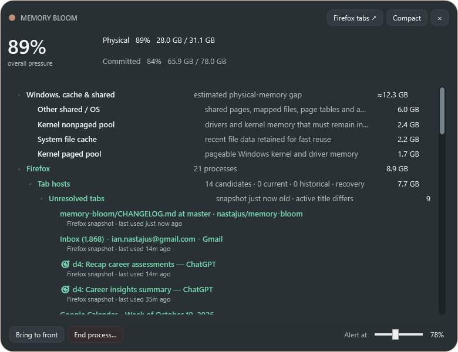

<p align="center">
  
</p>

# Memory Bloom

Memory Bloom is a quiet Windows memory-pressure companion. It stays invisible while memory is comfortable, then blooms into a small translucent signal as physical or committed memory becomes important. Click it for a process investigator when you need to understand what is using the machine.

## Compact when everything is fine

The primary view is deliberately small. Its ring, accent color, status language, and whole-window opacity intensify with memory pressure; hovering makes it fully opaque. It can remain tucked against either side of a monitor, appear only when its configured threshold is crossed, and disappear again after pressure settles.

| Comfortable state · normally hidden | High pressure · fully opaque on hover |
|---|---|
|  |  |

## Expanded when you need an explanation

A click opens the resizable investigator inward from the nearest monitor edge. It shows physical and committed memory, groups processes by application, and reconciles cache, kernel pools, and other shared Windows memory that ordinary per-process totals omit.



## What it does

- Appears automatically at a configurable pressure threshold and hides again with hysteresis.
- Makes its color, glow, gauge, and whole-window opacity more intense as pressure rises.
- Becomes fully opaque while hovered, then returns to its pressure-based opacity when the pointer leaves.
- Switches between a small compact view and a resizable detailed process view; detailed mode grows inward from whichever half of the monitor holds the compact view.
- Uses normal Windows dragging and Snap behavior, including the top-edge maximize preview.
- Appears in Alt+Tab with its own icon and pins its window across Windows virtual desktops.
- Preserves collapsed process branches across refreshes.
- Sorts app child processes and Firefox tab-host candidates by private memory, largest first.
- Brings a process window forward on double-click and offers dark right-click focus/end actions.
- Reconciles physical RAM not represented by process working sets into file cache, kernel pools, and other shared/OS memory.
- Starts at sign-in, lives in the notification area, and creates a desktop launcher.

## Firefox investigation

Firefox does not expose a supported, authoritative tab-to-Windows-PID mapping. Memory Bloom therefore keeps the distinction visible:

- Without the optional companion, tab titles and approximate last-accessed times come from Firefox's local recovery snapshot.
- The foreground Firefox title is observed live, so the active title can appear immediately instead of waiting for the recovery file.
- While the detailed view is open, a lightweight 250 ms sampler correlates tab activity with short CPU and working-set bursts in Firefox candidate tab-host processes.
- Repeated samples are accumulated and decayed. A title is nested beneath a process only when one candidate separates from the others.
- A current PID association lasts at most two minutes without fresh evidence. Its displayed confidence decays during that window; after expiry the title remains visibly attached as yellow historical evidence rather than being presented as current.
- Live titles are tracked per Firefox window. This prevents one ChatGPT tab from becoming several synthetic tabs as its document title changes, while the next recovery snapshot distinguishes navigation from a true tab switch.
- Unmatched titles remain under **Unresolved tabs**. Yellow text marks uncertain, aging, changed, or expired evidence.
- The optional local companion supplies stable tab IDs, titles, URLs, last-access times, and tab lifecycle events. It passes that metadata only to Memory Bloom's local native host; Firefox still does not expose each tab's Windows PID, so process placement remains measured inference.
- The **Firefox tabs ↗** button opens Firefox's authoritative `about:processes` page.

### Installing the Firefox companion

The companion is necessary for a prompt, complete catalog of open tabs. Without it, Memory Bloom falls back to Firefox's delayed recovery snapshot and the foreground window title; background tabs can therefore arrive minutes late or remain unknown. Install the local native host once with `install-firefox-companion-host.ps1`, then choose one extension path:

- **Temporary testing:** after every Firefox restart, open `about:debugging`, choose **This Firefox → Load Temporary Add-on**, and select [`firefox-extension/manifest.json`](firefox-extension/manifest.json). It remains loaded only for that browser session. Mozilla documents the same steps in [Temporary installation in Firefox](https://extensionworkshop.com/documentation/develop/temporary-installation-in-firefox/).
- **Persistent installation:** use a Mozilla-signed package. The recommended first release is **self-distributed/unlisted**: it stays out of AMO search while installing normally from a signed `.xpi`. Mozilla says automated signing can take up to 24 hours and longer when a submission receives manual review. See the companion's [submission and effort guide](firefox-extension/README.md) and Mozilla's [signing overview](https://extensionworkshop.com/documentation/publish/signing-and-distribution-overview/).

## Install and run

Memory Bloom currently targets Windows 11 and the .NET 10 Desktop Runtime.

1. Download [MemoryBloom.exe](docs/releases/v0.11.0/MemoryBloom.exe), or build it locally.
2. Run it once. Use `Ctrl+Alt+M` or the notification-area icon to bring it into focus.
3. To install sign-in startup and the desktop shortcut, run:

```powershell
.\install-startup.ps1 -LaunchNow
```

To build from source:

```powershell
.\build.ps1
```

The build is written to `release\MemoryBloom.exe`. Settings are stored under `%LOCALAPPDATA%\MemoryBloom`. Startup is current-user only and requires no administrator privileges.

## Controls

- Click the compact surface or detailed title bar to switch modes.
- Drag either surface normally; Windows handles edge Snap and maximize behavior.
- Use `+` / `−` or Ctrl + mouse wheel to scale the compact view.
- Right-click either the compact view or the detailed title bar and choose **Exit Memory Bloom** to quit.
- Double-click a process to bring its window forward.
- Right-click a process for **Bring to front** and **End process…**.
- Press `Ctrl+Alt+M` or double-click the tray icon to show details.

## Privacy and limitations

All memory, process, and Firefox recovery data is read locally. Memory Bloom sends no telemetry and does not upload browsing data.

Virtual-desktop pinning uses the Windows shell's own internal pinning service—the same behavior exposed as **Show this window on all desktops**. Microsoft does not publish that interface as a stable desktop API, so Memory Bloom treats pinning as best-effort and safely continues on one desktop if a future Windows update changes it.

The public changelog is in [CHANGELOG.md](CHANGELOG.md). The exhaustive engineering audit—including reported bugs, implementation challenges, decisions, limitations, and every retained screenshot—is kept separately in [docs/HISTORY.md](docs/HISTORY.md).
