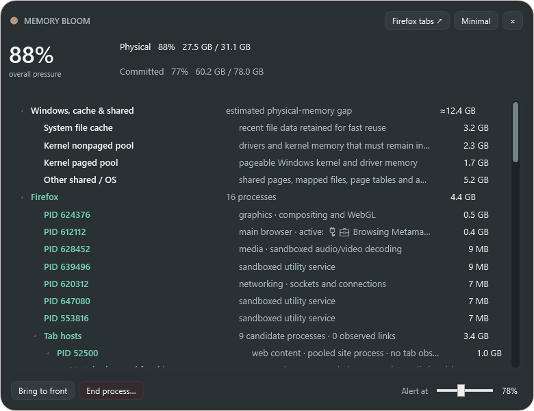
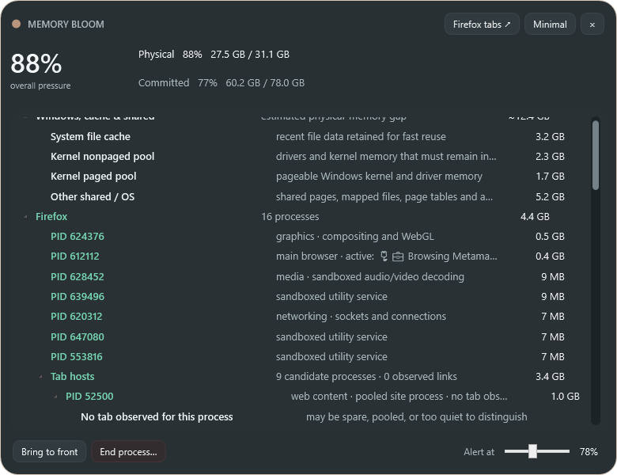
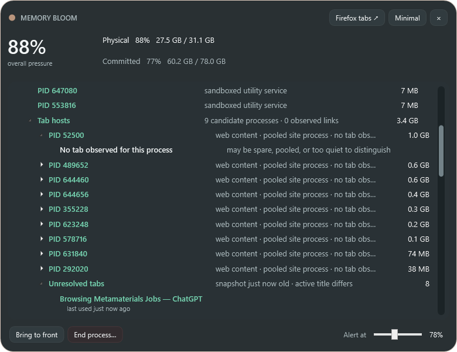

<p align="center">
  
</p>

# Memory Bloom

Memory Bloom is a quiet Windows memory-pressure companion. It stays invisible while memory is comfortable, then blooms into a small translucent signal as physical or committed memory becomes important. Click it for a process investigator when you need to understand what is using the machine.



## What it does

- Appears automatically at a configurable pressure threshold and hides again with hysteresis.
- Makes its color, glow, gauge, and whole-window opacity more intense as pressure rises.
- Becomes fully opaque while hovered, then returns to its pressure-based opacity when the pointer leaves.
- Switches between a tiny minimal view and a resizable detailed process view.
- Uses normal Windows dragging and Snap behavior, including the top-edge maximize preview.
- Appears in Alt+Tab with its own icon and pins its window across Windows virtual desktops.
- Preserves collapsed process branches across refreshes.
- Brings a process window forward on double-click and offers dark right-click focus/end actions.
- Reconciles physical RAM not represented by process working sets into file cache, kernel pools, and other shared/OS memory.
- Starts at sign-in, lives in the notification area, and creates a desktop launcher.

The compact view remains intentionally small:


## Firefox investigation

Firefox does not expose a supported, authoritative tab-to-Windows-PID mapping. Memory Bloom therefore keeps the distinction visible:

- Tab titles and approximate last-accessed times come from Firefox's local recovery snapshot.
- The foreground Firefox title is observed live, so the active title can appear immediately instead of waiting for the recovery file.
- While the detailed view is open, a lightweight 500 ms sampler correlates foreground-title changes with short CPU and working-set bursts in Firefox candidate tab-host processes.
- Repeated samples are accumulated and decayed. A title is nested beneath a process only when one candidate separates from the others.
- Unmatched titles remain under **Unresolved tabs**. Yellow text marks a stale, uncertain, or recently changed association.
- The **Firefox tabs ↗** button opens Firefox's authoritative `about:processes` page.





“Static” is not a Firefox state or a Memory Bloom age threshold. It was shorthand for a page that is currently too quiet to create a distinctive CPU or working-set signal. A newly opened blank tab, an idle loaded page, or a suspended/discarded background page can all be quiet. Disuse can make a page quieter, but time alone does not degrade a link; an existing observation is instead marked stale after five minutes. A normal Firefox extension could improve title freshness, stable tab identity, and tab actions, but Firefox's supported extension API still does not reveal the content-process PID.

## Install and run

Memory Bloom currently targets Windows 11 and the .NET 10 Desktop Runtime.

1. Download [MemoryBloom.exe](docs/releases/v0.6.0/MemoryBloom.exe), or build it locally.
2. Run it once. Use `Ctrl+Alt+M` or the notification-area icon to bring it into focus.
3. To install sign-in startup and the desktop shortcut, run:

```powershell
.\install-startup.ps1 -LaunchNow
```

To build from source:

```powershell
.\build.ps1
```

The build is written to `release\MemoryBloom.exe`. Settings are stored under `%LOCALAPPDATA%\MemoryBloom`. Startup is current-user only and requires no administrator privileges.

## Controls

- Click the compact surface or detailed title bar to switch modes.
- Drag either surface normally; Windows handles edge Snap and maximize behavior.
- Use `+` / `−` or Ctrl + mouse wheel to scale the compact view.
- Double-click a process to bring its window forward.
- Right-click a process for **Bring to front** and **End process…**.
- Press `Ctrl+Alt+M` or double-click the tray icon to show details.

## Privacy and limitations

All memory, process, and Firefox recovery data is read locally. Memory Bloom sends no telemetry and does not upload browsing data.

Virtual-desktop pinning uses the Windows shell's own internal pinning service—the same behavior exposed as **Show this window on all desktops**. Microsoft does not publish that interface as a stable desktop API, so Memory Bloom treats pinning as best-effort and safely continues on one desktop if a future Windows update changes it.

Development history, visual checkpoints, and next steps are recorded in [PROGRESS.md](PROGRESS.md) and [CHANGELOG.md](CHANGELOG.md).
