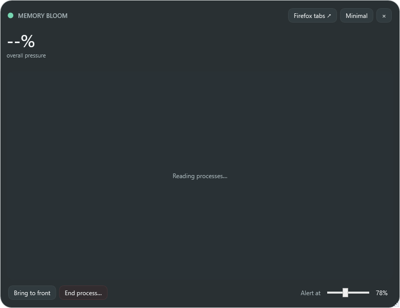

# Memory Bloom 0.1.0 — initial pressure companion

- Date: 2026-10-23 09:41 America/Toronto
- Commit: [`7bea78e`](https://github.com/nastajus/memory-bloom/commit/7bea78e)
- Release: [`MemoryBloom.exe`](../releases/v0.1.0/MemoryBloom.exe)

## Request and problems

The starting request was for a Windows memory-pressure app that normally remains invisible, appears only when memory use becomes important, and communicates increasing severity through both graphics and whole-window transparency. It needed to be friendly and discreet, occupy little space, support compact and detailed modes, allow subtle scaling, start at sign-in, identify troublesome apps, bring them forward, and end them. Firefox tab/process visibility was identified as an important but uncertain extension.

The project was placed in `app-memory-bloom` so it sorts near the top of the existing Windows tools folder.

## Implementation

- Created the native WPF application and pressure probe.
- Used the greater of physical-RAM use and committed-memory use as overall pressure.
- Added threshold-based appearance with a lower hide threshold to prevent flicker at the boundary.
- Tied gauge fill, accent color, glow, pulse, and whole-window opacity to pressure intensity.
- Added the compact pressure widget, detailed grouped-process view, compact zoom, tray controls, `Ctrl+Alt+M`, and process focus/end actions.
- Added current-user startup installation scripts.

## Challenges and decisions

- The app intentionally does not reserve screen space while memory is comfortable.
- Hysteresis was chosen instead of a single threshold so the window does not repeatedly appear and disappear near one percentage.
- Firefox tab attribution remained deferred because Windows process data alone does not reveal authoritative tab ownership.

## Visual evidence

- [Detailed view](../screenshots/v0.1.0/detailed.png)
- [Compact view](../screenshots/v0.1.0/minimal.png)

## Next state

Differentiate clicking from dragging, add direct process interactions, improve Firefox roles, and prevent expanded/collapsed state from resetting during refresh.
