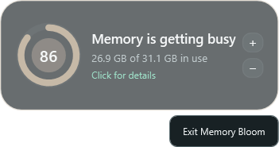

# Memory Bloom 0.10.0 — compact exit and documentation separation

- Date: 2026-10-23
- Release: [`MemoryBloom.exe`](../releases/v0.10.0/MemoryBloom.exe)
- Companion: [`MemoryBloom.Companion.xpi`](../releases/v0.10.0/MemoryBloom.Companion.xpi)

## Request and reported problem

- CHANGELOG and HISTORY had become nearly identical summaries with small differences, making it unclear which document was authoritative.
- The detailed `vX.Y.Z.md` records needed an obvious navigation point.
- Development language such as “staged” and timezone suffixes did not belong in public-facing headings.
- Compact mode needed a direct right-click exit action.

## Last state

- CHANGELOG repeated long implementation explanations, diagnostic screenshots, and much of the same iteration narrative as HISTORY.
- HISTORY linked the version files, but then repeated their detailed last/result/next narratives and maintained another screenshot archive below the index.
- The README called its low-pressure comparison a “staged comfortable state.”
- Exiting was available from the notification-area menu, but not from the compact surface itself.

## Resulting state

- README remains the concise product/portfolio landing page.
- CHANGELOG now contains only a few user-visible outcome bullets per release, with dates but no times or timezone suffixes.
- `docs/HISTORY.md` is the canonical audit index and current/next-state overview. Its version table links every exhaustive record from 0.1.0 through 0.10.0.
- Each `docs/history/vX.Y.Z.md` file is the authoritative checkpoint record containing requests, reported evidence, implementation detail, decisions, limitations, screenshots, and next state.
- The README pressure comparison now says “Comfortable state” without internal staging terminology.
- Right-clicking compact mode opens the existing dark WPF context-menu treatment with **Exit Memory Bloom**.
- The preview harness composes the actual WPF compact and context-menu visuals into a clean transparent PNG as a dedicated design checkpoint.

## Implementation and decisions

- The version links live in HISTORY, where a reader is explicitly seeking the audit trail. CHANGELOG deliberately stays self-contained and fast to scan; linking every bullet to deep implementation notes would blur the separation again.
- Screenshot assets remain centralized in `docs/screenshots/<version>/`. Version records link those canonical files instead of duplicating images into history folders.
- The compact menu contains only the requested exit action. Details remain a normal click, scaling remains on the visible buttons/Ctrl-wheel, and hide/show remains available from the tray.
- The context menu reuses the app-wide dark `ContextMenu` and `MenuItem` styles, so it matches process-row menus without a second theme implementation.

## Verification

- Release publish completed with zero warnings.
- Automated compact, detailed, Firefox, and four pressure-tier captures completed.
- The context-menu capture shows the full visual, dark surface, visible border, and complete exit label without unrelated desktop content.
- Markdown links were checked locally after the release files and screenshots were created.

## Visual evidence

- [Compact context menu](../screenshots/v0.10.0/compact-context-menu.png)
- [Compact state](../screenshots/v0.10.0/minimal.png)
- [Detailed state](../screenshots/v0.10.0/detailed.png)
- [Firefox process view](../screenshots/v0.10.0/firefox-processes.png)
- [Firefox unresolved view](../screenshots/v0.10.0/firefox-tabs.png)
- [Comfortable 55%](../screenshots/v0.10.0/tier-comfortable-55.png)
- [Rising 74%](../screenshots/v0.10.0/tier-rising-74.png)
- [Busy 82%](../screenshots/v0.10.0/tier-busy-82.png)
- [Critical 92%](../screenshots/v0.10.0/tier-critical-92.png)

## Next state

Validate the Firefox companion with ordinary tab activity, keep CHANGELOG terse as later features arrive, and keep all implementation evidence in the linked per-version records.
