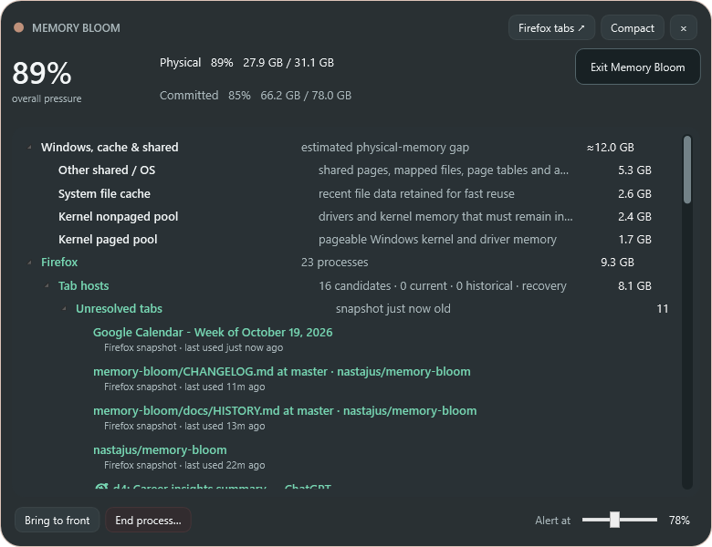

# Memory Bloom 0.11.0 — companion deployment and consistent root interactions

- Date: 2026-10-23
- Release: [`MemoryBloom.exe`](../releases/v0.11.0/MemoryBloom.exe)
- Companion: [`MemoryBloom.Companion.xpi`](../releases/v0.11.0/MemoryBloom.Companion.xpi)

## Request and concerns

- Explain the recurring `about:debugging` workflow and the effort/delay involved in Mozilla signing so a persistent-installation decision can be made.
- Document why the companion is necessary rather than presenting it as an unexplained optional extra.
- Add the same right-click exit action to the detailed title bar and establish that all future top-level pages should expose it.
- Ensure **Windows, cache & shared** participates in dynamic memory sorting instead of occupying a fixed first position.

## Last state

- Documentation said temporary loading disappeared after restart and persistent use required signing, but did not turn those facts into concrete steps, time estimates, or a recommendation.
- Compact mode had the dark exit menu; the detailed title bar did not.
- The refresh path sorted the system-memory reconciliation group after inserting it, but rendering trusted the incoming list order. A later render triggered by Firefox evidence could therefore not independently guarantee root ordering.

## Resulting state

- The public README briefly explains that the companion is required for prompt, complete tab catalog awareness and links both installation choices.
- The companion README now gives exact per-restart loading steps, an unlisted AMO submission walkthrough, future-update implications, official Mozilla references, and realistic effort/delay estimates.
- The native-host installer now works both from the source checkout and when shipped beside the native-host executable in a release folder.
- Compact mode and the detailed title bar use the same reusable dark context-menu resource and **Exit Memory Bloom** action.
- The contribution workflow now requires every future top-level mode/page to expose the shared exit action.
- Root groups are sorted by their current aggregate memory every time the tree is rendered. **Windows, cache & shared** therefore moves above or below application groups as its estimated gap changes; alphabetical order breaks exact memory ties.

## Firefox installation decision

Temporary loading requires opening `about:debugging`, selecting **This Firefox**, selecting **Load Temporary Add-on**, and choosing `manifest.json` after every Firefox restart. The native host is installed only once. Mozilla's `web-ext run` can automate development launches and reloads, but remains temporary and is not a transparent everyday-browser startup mechanism.

For persistence, the recommended initial channel is signed/unlisted self-distribution. The package remains absent from public AMO search, but standard Firefox accepts it across restarts. Submission requires an AMO developer account, a ZIP/XPI upload, automated validation, compatible-platform/source questions, and download/installation of the resulting signed XPI. Mozilla states signing may take up to 24 hours and longer if selected for manual review.

Memory Bloom's preparation burden should be relatively low because its extension is small, readable, unminified, has no generated bundle, has a stable native-messaging ID, and performs no network requests. Mozilla's validator did surface the newer required data-collection declaration. Because tab URLs, titles, and state cross from Firefox to the local native host, the manifest now declares `browsingActivity`, `websiteContent`, and `websiteActivity` rather than incorrectly claiming `none`; Firefox 140 is the minimum so its built-in consent UI can display those categories. This is an engineering assessment, not a guarantee of Mozilla approval or turnaround.

Official references:

- [Temporary installation](https://extensionworkshop.com/documentation/develop/temporary-installation-in-firefox/)
- [Submitting an add-on](https://extensionworkshop.com/documentation/publish/submitting-an-add-on/)
- [Signing and distribution](https://extensionworkshop.com/documentation/publish/signing-and-distribution-overview/)
- [Self-distributed installation](https://extensionworkshop.com/documentation/publish/install-self-distributed/)
- [Source-code submission](https://extensionworkshop.com/documentation/publish/source-code-submission/)
- [Built-in data consent](https://extensionworkshop.com/documentation/develop/firefox-builtin-data-consent/)

## Verification

- Release build completed with warnings treated as errors.
- Mozilla `web-ext` validation completed with zero errors, warnings, or notices after the required data-handling declaration was added.
- Automated compact, detailed, Firefox, pressure-tier, and both context-menu captures completed.
- The detailed context-menu capture confirms the complete dark exit menu is visible from the title surface.
- The detailed process capture records the live aggregate ordering used for this checkpoint.
- Local Markdown links were checked after release artifacts were assembled.

## Visual evidence

- [Detailed title-bar context menu](../screenshots/v0.11.0/detailed-titlebar-context-menu.png)
- [Compact context menu](../screenshots/v0.11.0/compact-context-menu.png)
- [Dynamic root ordering](../screenshots/v0.11.0/detailed.png)
- [Firefox process view](../screenshots/v0.11.0/firefox-processes.png)
- [Firefox unresolved view](../screenshots/v0.11.0/firefox-tabs.png)
- [Compact state](../screenshots/v0.11.0/minimal.png)

## Next state

Test the temporary companion across foreground and background tab changes, then submit an unlisted signed package once its catalog and native bridge are stable enough to avoid unnecessary signed-version churn.
