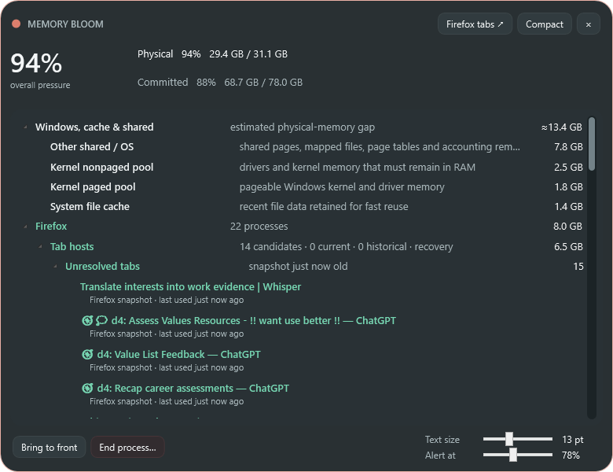
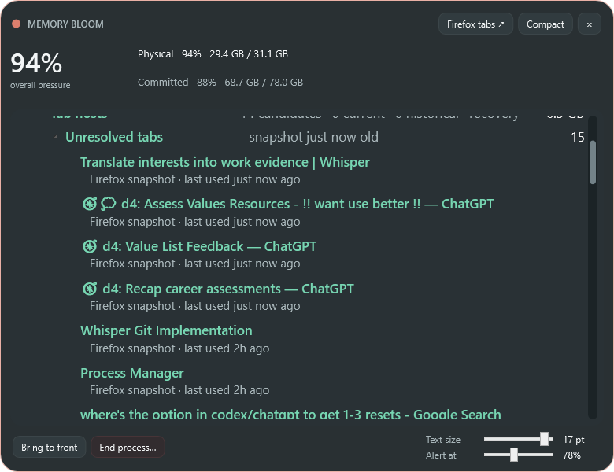

# Memory Bloom 0.12.0 — persistent process typography and responsive flow

- Date: 2026-10-23
- Release: [`MemoryBloom.exe`](../releases/v0.12.0/MemoryBloom.exe)
- Companion: [`MemoryBloom.Companion.xpi`](../releases/v0.12.0/MemoryBloom.Companion.xpi)

## Request

- Add a font-sizing slider to the process screen.
- Make the surrounding interface and process content flow logically around the selected size.

## Last state

- Detailed process text was fixed at 13 pt, while Firefox status lines were fixed at 11 pt.
- Process-row grids used hard-coded 650–680 px widths. Increasing font size alone would have produced premature clipping and inconsistent alignment rather than responsive flow.
- The footer overlaid a left action/status stack with a right alert stack, leaving no structured location for another setting.

## Resulting state

- A **Text size** slider provides persisted integer sizes from 10–18 pt and updates the visible tree immediately.
- Root groups, PIDs, descriptions, memory values, Firefox titles, and secondary status lines scale together; secondary lines remain two points smaller for hierarchy.
- Row heights grow naturally with font metrics.
- Header grids bind their width to the live process viewport minus hierarchy depth. Resizing the detailed window or changing font size therefore preserves indentation, allocates remaining room between title and description, and keeps memory values aligned near—but clear of—the scrollbar.
- The footer now has three explicit regions: process actions, a flexible ellipsized selection summary, and a right-side two-row settings block containing **Text size** above **Alert at**.
- The setting is stored with the existing per-user Memory Bloom settings and restored at startup.

## Implementation decisions

- Only investigative tree typography changes. The memory-pressure header and controls retain stable sizes, keeping operational controls predictable even at the 18 pt maximum.
- The slider snaps to whole-point values to avoid visually negligible fractional settings and excessive tree rebuilds while dragging.
- The minimum and maximum are deliberately bounded: 10 pt preserves dense investigation; 18 pt substantially improves visibility without making the hierarchy unusable in the 760 px minimum window.
- Changing size rebuilds the tree through its normal renderer, which preserves recorded expanded/collapsed state and applies the derived secondary-line size consistently.

## Verification

- Release build completed with warnings treated as errors.
- Automated normal and 17 pt detailed captures completed alongside the standard compact, Firefox, pressure-tier, and context-menu captures.
- Visual inspection confirmed the footer does not overlap, nested titles remain readable, row heights expand, and memory values remain visible before the scrollbar.
- Local Markdown links were checked after release artifacts were assembled.

## Visual evidence

- [Default 13 pt layout](../screenshots/v0.12.0/detailed.png)
- [Expanded 17 pt layout](../screenshots/v0.12.0/detailed-large-text.png)
- [Firefox titles at default size](../screenshots/v0.12.0/firefox-tabs.png)
- [Firefox process hierarchy](../screenshots/v0.12.0/firefox-processes.png)
- [Detailed title-bar context menu](../screenshots/v0.12.0/detailed-titlebar-context-menu.png)
- [Compact state](../screenshots/v0.12.0/minimal.png)

| Default · 13 pt | Enlarged · 17 pt |
|---|---|
|  |  |

## Next state

Observe the chosen typography during normal use at several window widths, then refine column proportions only if real process names or descriptions consistently lose more useful context than the other column.
