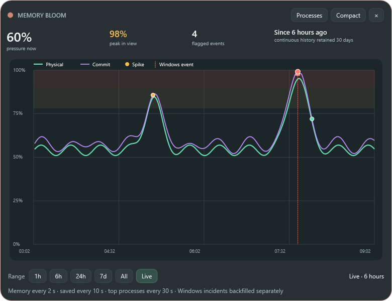
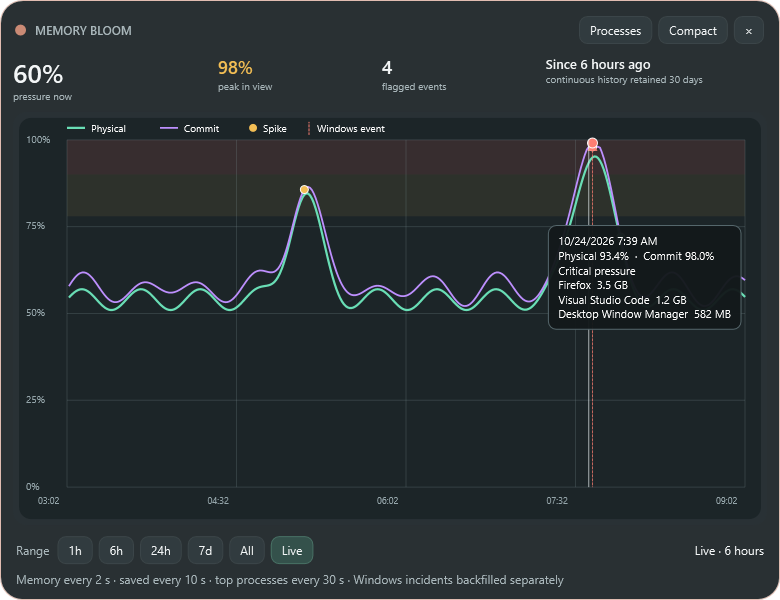

# Memory Bloom 0.13.0 — persistent pressure timeline and mode-aware Windows Snap

- Date: 2026-10-24
- Release: [`MemoryBloom.exe`](../releases/v0.13.0/MemoryBloom.exe)
- Companion: [`MemoryBloom.Companion.xpi`](../releases/v0.13.0/MemoryBloom.Companion.xpi)

## Request

- Prevent the initial compact screen from activating Windows edge Snap while retaining standard Snap behavior on non-compressed screens.
- Add a screen that tracks memory history, especially spikes and exceptional circumstances, for auditing crashes and out-of-memory failures.
- Backfill useful existing PC evidence where possible; otherwise make continuous Bloom operation and its limitations explicit.
- Make the timeline friendly, interactive, and zoomable, and provide direct switching between the process and history screens.
- Continue the automatic screenshot, exhaustive-history, release, commit, and push workflow.

## Last state

- Compact and detailed modes both used `ResizeMode.CanResize`, so sending the native caption drag to Windows made the small initial surface eligible for top-edge maximize and Snap.
- Bloom sampled current pressure but discarded every reading after updating the live display.
- There was no durable incident record, no way to see when a rise started, and no distinction between continuously measured history and evidence Windows happened to preserve.
- The expanded title bar led only to the process investigator.

## Resulting state

- Compact mode is now a normally draggable, non-resizable window. It explicitly rejects maximize commands and caption double-click maximize; expanded Process and History modes restore `CanResize` and normal Windows Snap/maximize behavior.
- A **History** button in Processes and a **Processes** button in History switch directly between the two expanded investigations. The shared title surface continues to provide Compact, hide, drag, click-to-compact, and dark right-click Exit behavior.
- Bloom measures physical and committed pressure every two seconds while running and saves a durable point every ten seconds. The leading eight private-memory consumers refresh every thirty seconds and travel with persisted samples so a spike has nearby process context.
- Sharp five-point rises within one minute, alert-threshold crossings, first entry into 90% critical pressure, and recovery below the hide threshold are flagged rather than treating every high sample as a new incident.
- The custom timeline draws independent physical and commit series, 78–90% warning and 90–100% critical zones, exceptional-point symbols, gaps when Bloom was not recording, and separate red Windows-event lines.
- Hover shows local time, exact percentages, state, and leading process context. Mouse wheel zooms around the pointer, horizontal drag pans, presets select 1 hour / 6 hours / 24 hours / 7 days / all retained data, and double-click or **Live** returns to the present.
- Data is retained for 30 days. Persisted normal samples remain high resolution for seven days, then compact to the highest-pressure point in each five-minute bucket; exceptional points remain. A long-running in-memory session similarly compacts older normal readings so monitoring does not grow without bound.

## Honest backfill and incident evidence

Windows does not normally retain a continuous historical RAM-percentage series, so Bloom cannot reconstruct the missing line before it started.

Bloom now reads up to 30 days of locally retained Windows Event Log evidence and plots it as event markers rather than synthetic samples:

- Resource Exhaustion Detector event 2004, including physical and committed memory levels plus the leading process names when present in the event payload.
- Kernel-Power event 41 and Event Log event 6008 for unexpected restarts/shutdowns.
- Application Error event 1000 and Windows Error Reporting event 1001 for application failures, error reports, and Windows leak-detection reports.

This PC contained genuine event 2004 records with exact pressure values and Firefox among the leaders, confirming that useful pre-Bloom incident evidence can be surfaced. Event availability and age still depend on Windows log retention, and a vertical event marker is never connected across an unmeasured period.

## Implementation decisions

- JSON Lines under `%LOCALAPPDATA%\MemoryBloom\memory-history.jsonl` keeps the first history format inspectable, append-friendly, recoverable after a partial final write, and free of a database dependency.
- The process context uses a lightweight process enumeration rather than the slower WMI hierarchy scan used by the open process investigator. Thirty-second context is detailed enough for retrospective suspects without imposing that scan every two seconds.
- Physical and committed percentages remain separate because either can be the limiting pressure and committed exhaustion can precede physical exhaustion.
- Crash/error markers are evidence of temporal correlation, not proof that memory caused a crash. Tooltips preserve that distinction.
- Preview captures use a deterministic six-hour synthetic series so documentation reliably demonstrates both ordinary fluctuations and exceptional states without publishing the user's live process history.

## Challenges and corrections during this iteration

- The first timeline preview used five-minute synthetic intervals while the chart intentionally broke lines across gaps longer than two minutes. The visual inspection correctly showed only isolated event points; preview data was changed to one-minute intervals so the documentation demonstrates continuous sampling while the production gap rule remains honest.
- Standard build output was temporarily locked by background .NET compiler processes. Verification was moved to isolated intermediate/output paths and completed with zero warnings; generated verification directories were excluded broadly so they cannot be compiled as source.
- Windows event 2004 stores its useful details under a namespaced `UserData` tree rather than ordinary `EventData`. Parsing was extended by local element name to recover exact physical/commit values and recorded leading processes.

## Verification

- Release build completed with warnings treated as errors: zero warnings and zero errors.
- The built-in preview captured Process, Firefox, compact, pressure-tier, context-menu, clean History, and interactive History-hover states.
- Visual inspection confirmed readable axes/legend, aligned summary cards, visible warning/critical zones, independent physical/commit lines, spike and Windows-event marks, unclipped controls, and a complete hover card.
- The compact implementation was verified to use `ResizeMode.NoResize` and reject maximize commands; both expanded pages restore `ResizeMode.CanResize` before display.
- Windows Event Log queries were exercised locally and returned Resource Exhaustion and Windows Error Reporting evidence without requiring network access.

## Visual evidence

- [Interactive history with exact hover/process detail](../screenshots/v0.13.0/history-hover.png)
- [Clean six-hour history overview](../screenshots/v0.13.0/history.png)
- [Process screen and History switch](../screenshots/v0.13.0/detailed.png)
- [Compact non-snapping surface](../screenshots/v0.13.0/minimal.png)
- [Detailed title context menu](../screenshots/v0.13.0/detailed-titlebar-context-menu.png)
- [Compact context menu](../screenshots/v0.13.0/compact-context-menu.png)
- [Firefox process hierarchy](../screenshots/v0.13.0/firefox-processes.png)
- [Firefox tab evidence](../screenshots/v0.13.0/firefox-tabs.png)
- [Large process typography](../screenshots/v0.13.0/detailed-large-text.png)
- [Comfortable pressure tier](../screenshots/v0.13.0/tier-comfortable-55.png)
- [Rising pressure tier](../screenshots/v0.13.0/tier-rising-74.png)
- [Busy pressure tier](../screenshots/v0.13.0/tier-busy-82.png)
- [Critical pressure tier](../screenshots/v0.13.0/tier-critical-92.png)

| Clean timeline | Exact interactive evidence |
|---|---|
|  |  |

## Limitations

- Continuous samples begin only while Memory Bloom is running. Shutdown, sleep, app downtime, and pre-install periods remain visible gaps.
- Event Log backfill is sparse and policy-dependent. Only Resource Exhaustion event 2004 contains historical memory values in this implementation; crash and shutdown markers provide time/context but not a full pressure sample.
- Periodic top-process context identifies strong suspects but does not prove causation and can be up to thirty seconds older than a saved point.
- History currently tracks aggregate system pressure and snapshot leaders, not an independent time series for every process or Firefox tab.

## Next state

Use the recorder through ordinary work and at least one real pressure event. The next useful refinement is an incident drawer that correlates a selected Windows marker with nearby Bloom samples, process leaders, rate of rise, peak, and recovery duration; per-application historical lines should wait until real investigations show they are worth the storage and visual complexity.
