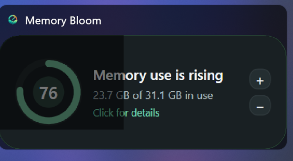
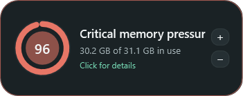

# Memory Bloom 0.14.0 — default hover-reveal orb and consistent Alt+Tab opacity

- Date: 2026-10-25
- Release: [`MemoryBloom.exe`](../releases/v0.14.0/MemoryBloom.exe)
- Companion: [`MemoryBloom.Companion.xpi`](../releases/v0.14.0/MemoryBloom.Companion.xpi)

## Request

- Fix inconsistent opacity in Windows Alt+Tab when the translucent compact card is kept partly off-screen.
- Consider that off-screen placement is being used to reduce Bloom's footprint during active work.
- Add a smaller compact option that displays only the pressure circle at rest, reveals text on hover, keeps the circle at the far right, and grows the explanation to its left.
- Make the new form the default while retaining the existing card as a setting available from Processes.
- Continue the automatic screenshot, exhaustive-history, release, commit, and push workflow.

## Reported state

The supplied Alt+Tab screenshot showed one compact card divided at a hard vertical boundary: the off-screen portion was rendered as a nearly black opaque slab while the visible portion retained the intended pressure-dependent translucency. This made one surface look as if it had two unrelated opacity levels.

## Cause and design response

- Memory Bloom used `AllowsTransparency=False` for standard Windows behavior but also set the native client background to `Transparent`, then applied pressure-based opacity to the entire window.
- Native rounded clipping hid the square client corners on the desktop, but DWM's Alt+Tab capture of a partly off-screen window could expose a black/transparent client-backing boundary. The boundary aligns with the kind of split visible in the report.
- The native window background is now the same opaque `#1A2225` panel color as Bloom. Whole-window opacity remains pressure-dependent, while DWM always receives one consistently backed surface. The native region still cuts the window to the same rounded geometry, so opaque square corners do not return.
- The more durable footprint solution is the new orb: users no longer need to hide most of a 292 px card beyond a monitor edge merely to leave a small pressure signal visible.

## Resulting state

- **Circle · text on hover** is the new default compact style.
- At rest it is a 92 × 92 px orb containing the existing animated pressure ring, pulse, percentage, pressure color, and proportional whole-window opacity.
- Hover makes the window fully opaque and expands it from 92 px to the normal 292 px width. Expansion is anchored to the existing right edge; the text appears to the left and the circle remains at the far right.
- Leaving the capsule collapses it back to the orb without moving that right-side anchor.
- The orb uses a half-width native corner radius, producing a true circular window at rest and a single pill outline while expanded.
- The original full card—with left circle, central text, and visible `+` / `−` controls—remains available.
- A new persistent **Compact** button in the lower-right Process settings cycles between **Circle · text on hover** and **Full card**. Ctrl + mouse wheel continues to scale either style.
- Existing users migrate once by preserving the previous card's right edge when its saved location is converted to the narrower orb. New users receive the orb automatically.

## Interaction and Windows behavior

- Both compact styles remain normally draggable, intentionally non-resizable, and excluded from Windows Snap/maximize.
- Clicking either the orb or its revealed capsule still opens Processes. Right-click still provides the shared dark **Exit Memory Bloom** action.
- Process and History screens remain ordinary resizable/Snap-enabled windows.
- Alt+Tab and the taskbar retain the Memory Bloom identity and icon. Moving the pointer away for Alt+Tab naturally returns the hover-reveal style to its single-orb representation.

## Verification

- Release build completed with warnings treated as errors: zero warnings and zero errors.
- The built-in preview captured the orb at rest, hover-expanded capsule, optional full card, Process setting, context menu, pressure tiers, History, and Firefox investigation states.
- Original-resolution inspection confirmed that the hover capsule grows left, the circle is rightmost, all text remains visible, and the orb/capsule share one clean outline without square backing corners.
- The staged executable was deployed with passive focus restoration. Windows automation inspected the live native v0.14 window and confirmed the running compact surface is the uniform orb rather than a partially backed card.
- The supplied problem image is retained above as the authoritative before-state evidence.

## Visual evidence

- [Reported before — split Alt+Tab opacity](../screenshots/v0.14.0/reported-before-alt-tab-opacity.png)
- [Default orb at rest](../screenshots/v0.14.0/minimal.png)
- [Hover-expanded capsule](../screenshots/v0.14.0/compact-hover.png)
- [Optional original full card](../screenshots/v0.14.0/compact-card.png)
- [Process screen with Compact setting](../screenshots/v0.14.0/detailed.png)
- [Compact right-click menu](../screenshots/v0.14.0/compact-context-menu.png)
- [Detailed title context menu](../screenshots/v0.14.0/detailed-titlebar-context-menu.png)
- [Memory history](../screenshots/v0.14.0/history.png)
- [Memory history hover evidence](../screenshots/v0.14.0/history-hover.png)
- [Firefox process hierarchy](../screenshots/v0.14.0/firefox-processes.png)
- [Firefox tab evidence](../screenshots/v0.14.0/firefox-tabs.png)
- [Large process typography](../screenshots/v0.14.0/detailed-large-text.png)
- [Comfortable pressure orb](../screenshots/v0.14.0/tier-comfortable-55.png)
- [Rising pressure orb](../screenshots/v0.14.0/tier-rising-74.png)
- [Busy pressure orb](../screenshots/v0.14.0/tier-busy-82.png)
- [Critical pressure orb](../screenshots/v0.14.0/tier-critical-92.png)

| At rest | On hover | Optional full card |
|---|---|---|
|  |  |  |

## Limitations and next state

- Windows' task switcher is owned by DWM, so Bloom cannot directly style its thumbnail independently of the source window. This release fixes the source surface and removes the transparent backing condition that produced the split; a future Windows compositor change can still affect thumbnails outside Bloom's control.
- A capsule expanding left needs enough usable space on that side. Bloom deliberately preserves the circle's anchor rather than jumping it elsewhere; a circle positioned at the far-left edge can therefore reveal part of its text off-screen.
- Observe the orb at the user's normal monitor edges and 1.2× saved scale. If the visible footprint can shrink further without weakening the signal, adjust only the orb diameter rather than returning to off-screen card placement.
