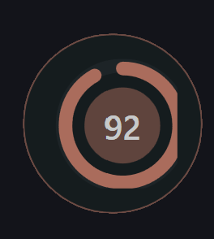
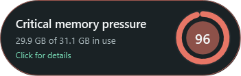
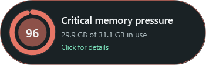

# Memory Bloom 0.15.0 — concentric orb geometry, stable hover, and edge-aware expansion

- Date: 2026-10-25
- Release: [`MemoryBloom.exe`](../releases/v0.15.0/MemoryBloom.exe)
- Companion: [`MemoryBloom.Companion.xpi`](../releases/v0.15.0/MemoryBloom.Companion.xpi)

## Request

- Center every part of the pressure orb perfectly and concentrically.
- Remove the visible vertical crop/flat cut on the orb's right side.
- Stop the hover race that rapidly alternated between the orb and the previous/full compact presentation.
- Choose the hover-expansion direction from the closest side of the active monitor, using the circle as the fixed screen-edge anchor just as expanded Processes grows inward.
- Continue the automatic screenshot, exhaustive-history, release, commit, and push workflow.

## Reported state

The supplied screenshot showed the circular gauge displaced within a rounded-square outer shell. The right side terminated in a straight vertical segment instead of completing the same curve as the left. Hover could also oscillate rapidly between collapsed and expanded compact layouts depending on the pointer's position during the resize.

## Root causes

- The orb window was 92 logical pixels wide, with a 1 px border and 12 px padding on each side. That left only 66 px of usable content for a 68 px gauge.
- Its grid also retained a 76 px fixed column inherited from the full card. The oversized column and gauge overflowed the usable circular interior, shifting the apparent center and meeting the native window boundary as a hard vertical crop.
- Hover expansion resized and repositioned the native window immediately. During the short interval when WPF hit testing and the native rounded region were updating, `MouseLeave` could fire and collapse the window; the now-visible pointer then caused `MouseEnter`, creating a repeat loop.
- Expansion was always right-anchored, regardless of the orb's monitor position.

## Resulting state

- Orb mode now uses 11 px shell padding. After the 1 px border, the 92 px window has exactly 68 px of usable width and height for the 68 px gauge.
- Collapsed mode uses an exact 68 px grid column. The shell circle, outer guide ellipse, pressure arc, pulse, and percentage therefore share the same geometric center with no overflow or clipped tangent.
- `MouseLeave` now starts a 180 ms one-shot debounce. If the pointer is back inside the resized window when it expires, collapse is cancelled; a genuine departure collapses once and restores pressure-based opacity.
- On expansion, Bloom reads the active monitor work area and compares the orb center with that monitor's midpoint:
  - nearest the left edge: the circle remains fixed on the left and text grows right;
  - nearest the right edge: the circle remains fixed on the right and text grows left.
- Collapse reverses the chosen expansion without moving the circle's edge-relative anchor.
- The same calculation is monitor-local, so an orb on the secondary monitor does not accidentally use the primary desktop's midpoint.

## Verification

- Release build completed with warnings treated as errors: zero warnings and zero errors.
- Deterministic preview captures now include both forced directional layouts in addition to the normal current-position hover state.
- Original-resolution inspection confirmed the 92 px shell and 68 px gauge are concentric, all circular strokes have equal clearance, and no vertical crop remains.
- Both expanded capsules retain complete text and a single rounded outline; the circle is leftmost for rightward expansion and rightmost for leftward expansion.
- The staged build was deployed with passive focus restoration for live observation.

## Visual evidence

- [Reported before — off-center and cropped orb](../screenshots/v0.15.0/reported-before-orb-centering-crop.png)
- [Corrected concentric orb](../screenshots/v0.15.0/minimal.png)
- [Right-edge anchor · text expands left](../screenshots/v0.15.0/compact-expand-left.png)
- [Left-edge anchor · text expands right](../screenshots/v0.15.0/compact-expand-right.png)
- [Current-position hover state](../screenshots/v0.15.0/compact-hover.png)
- [Optional full card](../screenshots/v0.15.0/compact-card.png)
- [Compact context menu](../screenshots/v0.15.0/compact-context-menu.png)
- [Process settings](../screenshots/v0.15.0/detailed.png)
- [Detailed title context menu](../screenshots/v0.15.0/detailed-titlebar-context-menu.png)
- [Memory history](../screenshots/v0.15.0/history.png)
- [Memory history hover](../screenshots/v0.15.0/history-hover.png)
- [Firefox processes](../screenshots/v0.15.0/firefox-processes.png)
- [Firefox tabs](../screenshots/v0.15.0/firefox-tabs.png)
- [Large process typography](../screenshots/v0.15.0/detailed-large-text.png)
- [Comfortable tier](../screenshots/v0.15.0/tier-comfortable-55.png)
- [Rising tier](../screenshots/v0.15.0/tier-rising-74.png)
- [Busy tier](../screenshots/v0.15.0/tier-busy-82.png)
- [Critical tier](../screenshots/v0.15.0/tier-critical-92.png)

| Corrected orb | Right-edge anchor | Left-edge anchor |
|---|---|---|
|  |  |  |

## Limitations and next state

- Expansion direction is selected when hover begins. Bloom does not reverse an already-open capsule if it is dragged across the monitor midpoint; the next collapse/hover cycle recalculates it.
- A circle centered exactly on the monitor midpoint resolves to the right-side rule and expands left.
- Observe real transitions on both monitors and at the saved 1.2× scale. If mixed-DPI monitor boundaries expose ambiguity, base the next refinement on the monitor containing the largest part of the orb rather than only its center.
