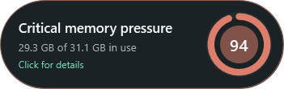
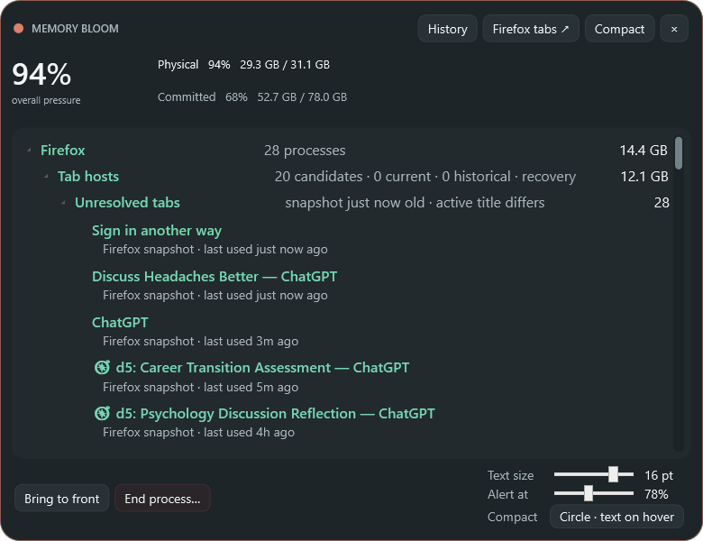

# Memory Bloom 0.16.0 — reliable relaunch of a hidden single instance

- Date: 2026-10-29
- Release: [`MemoryBloom.exe`](../releases/v0.16.0/MemoryBloom.exe)
- Companion: [`MemoryBloom.Companion.xpi`](../releases/v0.16.0/MemoryBloom.Companion.xpi)

## Request

- Diagnose why Memory Bloom would not appear when launched and seemed to have died since the morning.
- Restore the app if it was still running but invisible.
- Continue the automatic screenshot, exhaustive-history, release, commit, and push workflow for the resulting functional correction.

## Reported and last state

Bloom appeared to ignore repeated launch attempts. Process inspection showed that it had not crashed: a responsive `MemoryBloom.exe` instance had been running since 2026-10-28 17:03, owned a native window titled **Memory Bloom**, retained its tray icon and sampling threads, and remained registered for sign-in startup. Its window was hidden because pressure was below the configured threshold.

The desktop shortcut was also healthy and targeted the installed release executable. The failure was therefore not a missing binary, broken shortcut, failed startup entry, or application exit.

## Root cause and challenge

- Bloom correctly uses a named mutex to prevent duplicate monitors, tray icons, Firefox listeners, and history writers.
- When a second launch found that mutex, it immediately shut down.
- There was no inter-process message telling the existing threshold-hidden instance that the user had explicitly tried to open Bloom.
- Consequently, the safest single-instance behavior also made the executable and desktop shortcut look dead whenever the primary window was hidden.
- The correction had to preserve one process while crossing from a background thread back to WPF's UI dispatcher safely.

## Resulting state

- The primary instance now creates a session-local named auto-reset event alongside the existing mutex and registers a reusable wait for it.
- A later launch that encounters the mutex signals that event before exiting.
- The primary process marshals the signal onto WPF's dispatcher and opens the detailed Processes view through the normal `ShowDetails` path, including activation and edge-aware placement.
- Repeated launches continue to produce exactly one monitoring process; no duplicate tray icon, timer, history stream, or Firefox companion server is created.
- The event wait, event handle, and mutex are unregistered/disposed during normal shutdown.
- The already-running 0.15.0 instance was first restored using the focus-preserving restart helper, then replaced by the corrected 0.16.0 executable.

## Verification

- The release and native host published successfully with no build warnings or errors.
- The installed release reports file version `0.16.0.0`.
- The desktop shortcut resolves to `release/MemoryBloom.exe` and its target exists.
- Integration test:
  1. restart Bloom without `--show`, leaving its primary window threshold-hidden;
  2. launch the same executable again with no arguments;
  3. observe one process both before and after (`PID 173824` during the test);
  4. confirm that the original process exposes a responsive native **Memory Bloom** window instead of creating a second process.
- Windows app discovery confirmed the resulting visible window after the signaling launch.
- The deterministic preview suite produced all 17 expected images. Original-resolution inspection of the orb, hover capsule, and detailed view found no clipping, overlap, or visual regression.

## Visual evidence

- [Concentric pressure orb](../screenshots/v0.16.0/minimal.png)
- [Current-position hover capsule](../screenshots/v0.16.0/compact-hover.png)
- [Right-edge anchor · text expands left](../screenshots/v0.16.0/compact-expand-left.png)
- [Left-edge anchor · text expands right](../screenshots/v0.16.0/compact-expand-right.png)
- [Optional full compact card](../screenshots/v0.16.0/compact-card.png)
- [Compact context menu](../screenshots/v0.16.0/compact-context-menu.png)
- [Detailed process view](../screenshots/v0.16.0/detailed.png)
- [Detailed title context menu](../screenshots/v0.16.0/detailed-titlebar-context-menu.png)
- [Large process typography](../screenshots/v0.16.0/detailed-large-text.png)
- [Firefox processes](../screenshots/v0.16.0/firefox-processes.png)
- [Firefox tabs](../screenshots/v0.16.0/firefox-tabs.png)
- [Memory history](../screenshots/v0.16.0/history.png)
- [Memory history hover](../screenshots/v0.16.0/history-hover.png)
- [Comfortable tier](../screenshots/v0.16.0/tier-comfortable-55.png)
- [Rising tier](../screenshots/v0.16.0/tier-rising-74.png)
- [Busy tier](../screenshots/v0.16.0/tier-busy-82.png)
- [Critical tier](../screenshots/v0.16.0/tier-critical-92.png)

| Hidden/resting form | Relaunch result | Expanded investigator |
|---|---|---|
|  |  |  |

## Decisions and limitations

- The signal is scoped to the current Windows logon session, matching the current-user startup entry and preventing cross-user interference.
- A relaunch intentionally opens the full detailed view because launching is an explicit request to interact, whereas threshold visibility continues to control the passive compact signal.
- If the primary process is alive but its UI thread is genuinely hung, it cannot service the event. Version 0.16.0 does not kill such a process automatically; an explicit recovery prompt is safer than destroying local history state without evidence.
- Windows foreground-stealing rules may occasionally flash the taskbar instead of transferring keyboard focus, but the window is still made visible.

## Next state

- Observe relaunch after routine sign-in and after long threshold-hidden periods.
- Add an unresponsive-primary detection/recovery prompt only if real usage demonstrates that a healthy signal path is insufficient.
- Continue evaluating the history timeline with real memory spikes and resource-exhaustion incidents.
