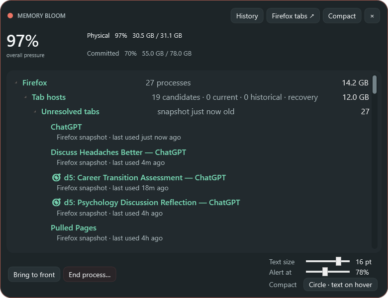
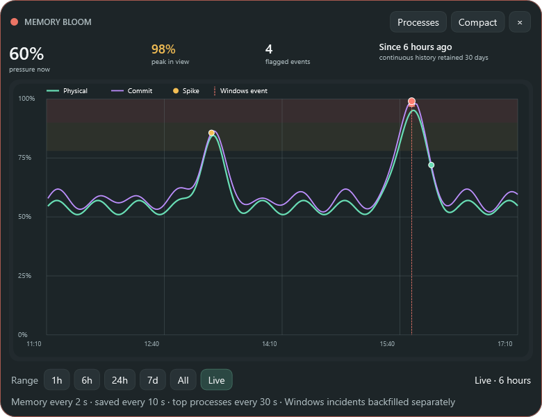

# Memory Bloom 0.17.0 — four-way anchored expanded placement

- Date: 2026-10-29
- Release: [`MemoryBloom.exe`](../releases/v0.17.0/MemoryBloom.exe)
- Companion: [`MemoryBloom.Companion.xpi`](../releases/v0.17.0/MemoryBloom.Companion.xpi)

## Request

- Prevent the large Process window from opening one-quarter to one-half beyond the right edge by default.
- Treat the compact control as the reference anchor for all larger Process and History screens.
- Choose both horizontal and vertical growth directions from the compact control's closest monitor edges: right/left and bottom/top respectively.
- Permit an off-screen expanded position only when the user deliberately moved it there, and remember that choice across reboots.
- Continue the automatic screenshot, exhaustive-history, release, commit, and push workflow.

## Reported and last state

The existing expansion logic understood only the left/right relationship. It captured the compact control's horizontal bounds and grew the 780 × 600 investigator inward, but it used the compact control's top coordinate for every vertical placement. More importantly, its right-side clamp protected only the left edge. A compact orb intentionally parked partly beyond the right monitor edge could therefore pull the expanded investigator partly beyond that edge as well.

Compact and expanded locations also shared the same persisted `Left`/`Top` setting. That did not express the important distinction between the canonical compact anchor and a separate expanded position the user deliberately chose.

## Root cause and challenges

- Horizontal placement used `compactRight - expandedWidth` without a final clamp against the work area's maximum left coordinate.
- Vertical placement always grew downward from `compactTop`; it did not retain `compactBottom` or determine the nearest vertical edge.
- A default computed position and a user-dragged expanded position needed distinct persistence semantics.
- The compact control is often kept partly off-screen by design, but that should not make a much larger default view inaccessible.
- Windows reports monitor work areas in physical pixels while WPF window coordinates are device-independent. The existing monitor lookup correctly transforms work-area bounds into WPF coordinates; the correction had to preserve that conversion rather than mix coordinate spaces.
- During the final passive restart, Windows retained a zero-thread, zero-handle process remnant whose executable path was redacted. The development restart helper originally treated it as a live candidate, could neither terminate it nor replace its still-mapped image, and stopped before launching the healthy instance.

## Resulting state

- Entering an expanded screen captures all four compact bounds and selects the nearest left/right and top/bottom work-area edges from the compact control's center.
- Left-anchored controls align expanded left to compact left; right-anchored controls align expanded right to compact right. Top-anchored controls grow down; bottom-anchored controls grow up.
- The computed rectangle is clamped on both axes, so the default Process or History view is fully contained by the compact control's monitor even when the compact control itself is partly beyond an edge.
- Expanded minimum and requested dimensions are constrained to unusually small work areas instead of forcing inaccessible overflow.
- Compact `Left`/`Top` remains the canonical anchor. Expanded screens now have separate optional persisted coordinates plus an explicit user-set flag.
- In the default orb style, the 92 px circle is the canonical geometry even while its hover text capsule is open. A right-edge drag saves the circle's right-side position rather than the capsule's temporary left edge, preventing a reboot-time jump and preventing hover width from changing the nearest-side decision.
- A title-bar drag in expanded mode records that location as an intentional override and restores it across later launches. Returning to compact still restores the original compact anchor.
- Moving the compact control clears the expanded override, making the new compact position authoritative. If a saved expanded override is no longer sufficiently reachable after a display-layout change, Bloom discards it and falls back to safe four-way anchoring.
- Process and History share the same expanded shell, so switching pages preserves the placement consistently.
- The focus-preserving development restart helper now ignores zero-thread process remnants and can still identify a live project instance when Windows redacts its path. This avoids mistaking a defunct process object for the running app during future releases.

## Verification

- `dotnet build MemoryBloom.csproj -c Release -r win-x64 -warnaserror` completed with zero warnings and zero errors.
- The published executable reports file version `0.17.0.0`.
- A four-corner geometry matrix covered top-left, top-right, bottom-left, and bottom-right compact anchors on a 1280 × 720 work area. It also used partially off-screen top-right and bottom-right compact inputs; every resulting 780 × 600 expanded rectangle remained within `0,0–1280,720` while preserving its intended anchor edge.
- Live native-window inspection found the expanded 0.17.0 window fully inside the current 1280 × 720 work area.
- The installed 0.17.0 release restarted through the passive helper with the prior foreground window restored, then exposed exactly one healthy live process; the unrelated zero-thread Windows remnant was excluded from that live-process assertion.
- The deterministic preview suite produced all 17 expected images. Original-resolution inspection of the detailed Process screen, compact orb, hover capsule, and History screen found no clipping, overlap, or visual regression.

## Visual evidence

Placement is monitor-relative behavior, while these deterministic captures intentionally isolate the window itself. The geometry matrix and live native bounds above verify placement; the images verify that the placement changes did not disturb the app's rendering.

- [Concentric pressure orb](../screenshots/v0.17.0/minimal.png)
- [Current-position hover capsule](../screenshots/v0.17.0/compact-hover.png)
- [Right-edge anchor · text expands left](../screenshots/v0.17.0/compact-expand-left.png)
- [Left-edge anchor · text expands right](../screenshots/v0.17.0/compact-expand-right.png)
- [Optional full compact card](../screenshots/v0.17.0/compact-card.png)
- [Compact context menu](../screenshots/v0.17.0/compact-context-menu.png)
- [Detailed process view](../screenshots/v0.17.0/detailed.png)
- [Detailed title context menu](../screenshots/v0.17.0/detailed-titlebar-context-menu.png)
- [Large process typography](../screenshots/v0.17.0/detailed-large-text.png)
- [Firefox processes](../screenshots/v0.17.0/firefox-processes.png)
- [Firefox tabs](../screenshots/v0.17.0/firefox-tabs.png)
- [Memory history](../screenshots/v0.17.0/history.png)
- [Memory history hover](../screenshots/v0.17.0/history-hover.png)
- [Comfortable tier](../screenshots/v0.17.0/tier-comfortable-55.png)
- [Rising tier](../screenshots/v0.17.0/tier-rising-74.png)
- [Busy tier](../screenshots/v0.17.0/tier-busy-82.png)
- [Critical tier](../screenshots/v0.17.0/tier-critical-92.png)

| Compact reference | Expanded Process screen | Expanded History screen |
|---|---|---|
|  |  |  |

## Decisions and limitations

- Compact position wins by default because it is the small control the user intentionally places around their workspace. Expanded position wins only after an explicit expanded drag.
- A saved expanded override may remain partly off-screen if at least 160 logical pixels of width and 50 logical pixels of height are reachable. That is the deliberate exception requested by the user; a less reachable rectangle is treated as stale display-layout data.
- Version 0.17.0 remembers an intentional expanded position but not a separate expanded size. The consistent default size avoids surprising growth after a previous Snap/maximize session; size persistence can be added later if real use warrants it.
- Deterministic preview PNGs do not include the desktop boundary, so monitor-relative correctness is verified numerically and against live native bounds rather than inferred from a cropped window image.

## Next state

- Observe all four anchors during ordinary use on the user's real monitor arrangement and after Windows display-scale or topology changes.
- Decide from use whether a deliberate expanded resize should also persist independently from the compact anchor.
- Continue evaluating the History screen against real spikes and resource-exhaustion incidents.
