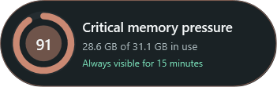
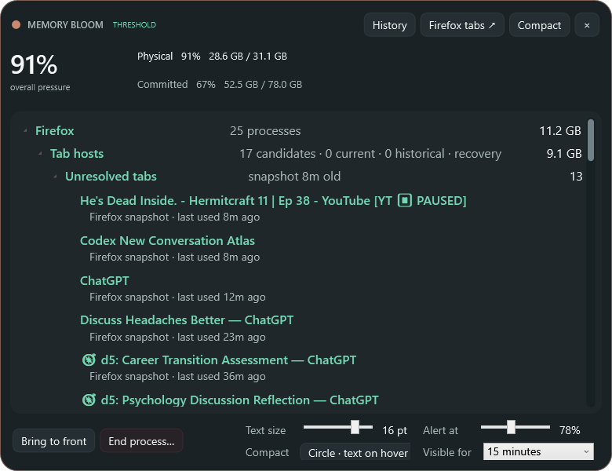

# Memory Bloom 0.18.0 — temporary always-visible policy and timeout

- Date: 2026-10-29
- Release: [`MemoryBloom.exe`](../releases/v0.18.0/MemoryBloom.exe)
- Companion: [`MemoryBloom.Companion.xpi`](../releases/v0.18.0/MemoryBloom.Companion.xpi)

## Request

- Preserve threshold hiding as desirable normal behavior while providing a reliable way to reveal Bloom when memory is comfortable.
- Make `Ctrl+Alt+B` toggle visibility between always on and threshold controlled.
- Do not dedicate the global shortcut to the full investigator.
- Add small in-app feedback for the current visibility policy.
- Add a configurable automatic timeout with a reasonable default.
- Assess whether the system-tray icon is worth retaining when the main interface can be invisible.

## Reported and last state

Threshold hiding worked as designed, but it made the app feel inaccessible when the user wanted to inspect it during comfortable memory use. Version 0.17.0 still registered `Ctrl+Alt+M` as a direct full-investigator shortcut. The desktop launcher and tray could reveal the app, but the shortcut did not express the requested distinction between a temporary visible compact signal and the threshold policy itself.

## Decisions

- `Ctrl+Alt+B` is now a policy toggle rather than a page-navigation command.
- Every application boot begins in **Threshold controlled**. The selected timeout duration persists; the always-visible state itself does not, preventing an old temporary override from silently surviving a reboot.
- The default is 15 minutes: long enough for a normal investigation without making a conditional ambient indicator permanently occupy the desktop after it is forgotten.
- Processes offers 5, 15, 30, and 60 minutes plus **Until toggled**. Changing the selection while always-visible restarts the timeout from that choice.
- The tray icon is retained. A global hotkey provides fast access but can be reserved by another application or forgotten; the tray remains Windows' conventional discoverable surface for a background monitor, exposes explicit Exit, and supplies access if the main window is absent. Because the tray integration already existed, retaining it adds essentially no new implementation complexity in this checkpoint.

## Resulting state

- Pressing `Ctrl+Alt+B` while threshold-controlled makes the compact view visible without opening Processes or History.
- Pressing it again restores threshold control. At comfortable pressure, Bloom keeps the compact confirmation visible for three seconds before hiding; at elevated pressure it remains visible because the threshold itself warrants it.
- Compact hover text reports the change (for example, **Always visible for 15 minutes**) and later shows the current policy/countdown. The expanded title bar mirrors that state.
- When the configured always-visible period expires, Bloom reports **Threshold restored · timeout**, clears any manual compact hold, and resumes the normal threshold/hysteresis rules.
- The Process footer includes **Visible for** with 5, 15, 30, 60 minutes, or Until toggled. The default and migration fallback are 15 minutes.
- The tray menu exposes the same visibility toggle in addition to its existing Process, History, compact, threshold-hide, and Exit actions. Double-click still opens details; there is no dedicated full-investigator hotkey.

## Verification

- Release and native-host builds completed with warnings treated as errors.
- Live Windows verification pressed `Ctrl+Alt+B` against the running 0.18.0 app. The compact capsule remained compact and displayed **Always visible for 15 minutes**; it did not open the investigator.
- A second live toggle in the expanded view displayed **Threshold controlled**, confirming that the same shortcut changes policy without page navigation.
- The expanded Process screen exposed the 15-minute selector and current policy indicator without footer clipping.
- A first regression capture showed the fourth setting row below the rounded edge at 17 pt process text. The footer was reflowed into a compact two-column, two-row settings grid; the repeated capture retains both complete rows at the enlarged typography setting.
- The deterministic preview suite includes a dedicated compact visibility-toggle capture in addition to the established visual regression set.

## Visual evidence

- [Visibility-toggle confirmation](../screenshots/v0.18.0/visibility-toggle.png)
- [Concentric pressure orb](../screenshots/v0.18.0/minimal.png)
- [Current-position hover capsule](../screenshots/v0.18.0/compact-hover.png)
- [Right-edge anchor · text expands left](../screenshots/v0.18.0/compact-expand-left.png)
- [Left-edge anchor · text expands right](../screenshots/v0.18.0/compact-expand-right.png)
- [Optional full compact card](../screenshots/v0.18.0/compact-card.png)
- [Compact context menu](../screenshots/v0.18.0/compact-context-menu.png)
- [Detailed process view and timeout selector](../screenshots/v0.18.0/detailed.png)
- [Detailed title context menu](../screenshots/v0.18.0/detailed-titlebar-context-menu.png)
- [Large process typography](../screenshots/v0.18.0/detailed-large-text.png)
- [Firefox processes](../screenshots/v0.18.0/firefox-processes.png)
- [Firefox tabs](../screenshots/v0.18.0/firefox-tabs.png)
- [Memory history](../screenshots/v0.18.0/history.png)
- [Memory history hover](../screenshots/v0.18.0/history-hover.png)
- [Comfortable tier](../screenshots/v0.18.0/tier-comfortable-55.png)
- [Rising tier](../screenshots/v0.18.0/tier-rising-74.png)
- [Busy tier](../screenshots/v0.18.0/tier-busy-82.png)
- [Critical tier](../screenshots/v0.18.0/tier-critical-92.png)

| Threshold compact state | Visibility-toggle feedback | Process setting |
|---|---|---|
|  |  |  |

## Limitations and next state

- The timeout is wall-clock based from the moment always-visible mode is enabled or its duration changes; it is not a countdown from Windows sign-in.
- The tray icon is not optional in 0.18.0. If real use shows the global shortcut is reliable and discoverable enough, a future preference could hide it while retaining the sign-in background process.
- Observe whether 15 minutes feels appropriately quiet or should become shorter, and whether the compact countdown needs minute-by-minute precision beyond its current rounded display.
