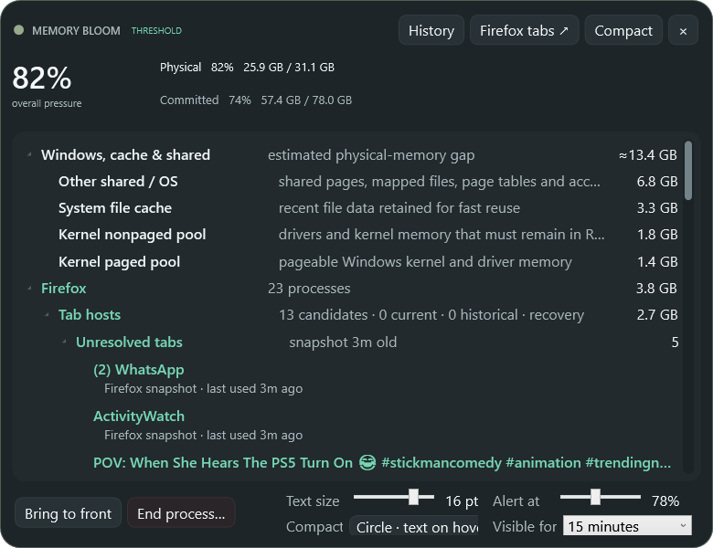
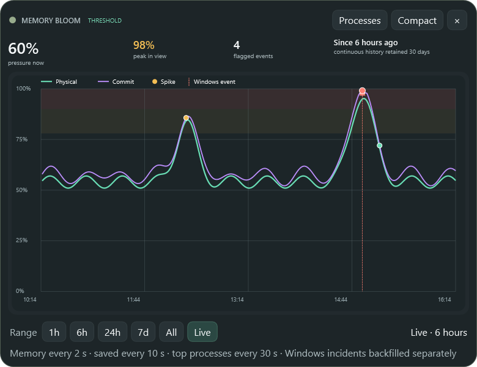

# Memory Bloom 0.19.0 — self-healing virtual-desktop visibility

- Date: 2026-11-07
- Release: [`MemoryBloom.exe`](../releases/v0.19.0/MemoryBloom.exe)
- Companion: [`MemoryBloom.Companion.xpi`](../releases/v0.19.0/MemoryBloom.Companion.xpi)

## Request

- Diagnose why Memory Bloom recently stopped remaining visible across multiple Windows virtual desktops.
- Restore persistent cross-desktop visibility and account for the possibility that a recent version changed the behavior.
- Continue the automatic screenshot, exhaustive-history, release, commit, and push workflow.

## Reported and measured last state

Bloom had previously followed the user across virtual desktops but recently remained limited to one desktop. The code attempted pinning only during the window's initial `SourceInitialized` event and cached one successful result in `_virtualDesktopPinned` for the lifetime of the process.

A live read-only query of Windows' virtual-desktop shell service against the installed 0.18.0 window measured the failure directly:

```text
ViewPinned=False AppPinned=False
```

Bloom's process was healthy and its window handle remained valid. The problem was not app shutdown or threshold hiding: the shell no longer considered either the window view or Memory Bloom's app identity pinned.

## Root cause

- `_virtualDesktopPinned` represented an old successful attempt, not current Windows shell state.
- Once true, it permanently suppressed every future pin attempt.
- Explorer restart, virtual-desktop shell churn, or a hide/show/reveal transition could discard the shell's transient view pin while Bloom retained the stale in-process Boolean.
- Version 0.18.0 added more visibility-policy transitions. Those transitions did not themselves unpin the window, but they made the older one-shot assumption more likely to surface as a recent regression.
- The implementation pinned only the current `IApplicationView`; it did not also pin the stable `MemoryBloom.App` identity that Bloom already assigns through `SetCurrentProcessExplicitAppUserModelID`.

## Resulting state

- The one-time latch has become a health check. Bloom asks Windows to ensure the pin after initial handle creation, every compact/detail reveal, every threshold or always-visible reveal, and every 30 seconds while the window remains visible.
- Each check queries actual shell state. If Windows has dropped the pin, Bloom pins the current view again instead of trusting an old success flag.
- Bloom now also pins its stable `MemoryBloom.App` identity. View pinning remains the authoritative fallback on shell versions that reject app-ID pinning through the internal interface.
- Concurrent checks are coalesced, successful checks are rate-limited, and a transient registration race still receives the existing three attempts at 350 ms intervals.
- Threshold-hidden periods do not generate needless shell traffic. The next reveal performs a forced check immediately.
- [`tools/verify-virtual-desktop-pin.ps1`](../../tools/verify-virtual-desktop-pin.ps1) reports the live view/app pin state and has an explicit `-UnpinForRecoveryTest` switch for controlled regression testing.

## Verification

- The application and native host published with warnings treated as errors.
- After installing 0.19.0, the same live shell probe that reported both pins false on 0.18.0 reported:

```text
ViewPinned=True AppPinned=True
```

- Recovery test:
  1. explicitly remove Memory Bloom's current view pin and app-ID pin through the diagnostic switch;
  2. confirm `ViewPinned=False AppPinned=False`;
  3. leave the app running without restart or interaction;
  4. wait for the 30-second health interval;
  5. confirm `ViewPinned=True AppPinned=True`.
- Windows app inspection found the repaired compact orb present and rendering normally after the recovery test.
- The deterministic preview suite retained all 18 expected images. Original-resolution inspection of the orb, detailed process view, large-text footer, and History page found no visual regression.

## Visual evidence

The pin is shell state rather than a drawable UI element, so the before/after shell readings and forced recovery test above are the authoritative functional evidence. These captures document the resulting 0.19.0 UI and verify the pinning lifecycle changes did not disturb rendering.

- [Concentric pressure orb](../screenshots/v0.19.0/minimal.png)
- [Visibility-toggle confirmation](../screenshots/v0.19.0/visibility-toggle.png)
- [Current-position hover capsule](../screenshots/v0.19.0/compact-hover.png)
- [Right-edge anchor · text expands left](../screenshots/v0.19.0/compact-expand-left.png)
- [Left-edge anchor · text expands right](../screenshots/v0.19.0/compact-expand-right.png)
- [Optional full compact card](../screenshots/v0.19.0/compact-card.png)
- [Compact context menu](../screenshots/v0.19.0/compact-context-menu.png)
- [Detailed process view](../screenshots/v0.19.0/detailed.png)
- [Detailed title context menu](../screenshots/v0.19.0/detailed-titlebar-context-menu.png)
- [Large process typography](../screenshots/v0.19.0/detailed-large-text.png)
- [Firefox processes](../screenshots/v0.19.0/firefox-processes.png)
- [Firefox tabs](../screenshots/v0.19.0/firefox-tabs.png)
- [Memory history](../screenshots/v0.19.0/history.png)
- [Memory history hover](../screenshots/v0.19.0/history-hover.png)
- [Comfortable tier](../screenshots/v0.19.0/tier-comfortable-55.png)
- [Rising tier](../screenshots/v0.19.0/tier-rising-74.png)
- [Busy tier](../screenshots/v0.19.0/tier-busy-82.png)
- [Critical tier](../screenshots/v0.19.0/tier-critical-92.png)

| Compact state | Detailed process view | History view |
|---|---|---|
|  |  |  |

## Challenges, decisions, and limitations

- The first preview run used Windows' hidden-window process flag and produced invalid compact captures in detailed-image slots because WPF's visible layout lifecycle did not run normally. The established visible renderer was rerun and replaced those files before inspection.
- The app-ID pin is intentionally additive rather than a substitute for the current view pin. This protects handle/view churn while preserving compatibility with shell versions where only view pinning succeeds.
- The 30-second interval is a compromise: recovery is prompt enough for desktop switching without invoking an undocumented COM service every two-second memory sample.
- Windows' virtual-desktop pinning service remains an undocumented shell interface. Version 0.19.0 detects and repairs lost state on the current Windows build, but a future incompatible interface change can still make best-effort pinning unavailable.

## Next state

- Observe behavior through real Explorer restarts, long threshold-hidden periods, and frequent desktop switching.
- If the interface changes, surface the existing probe state discreetly in-app before considering version-specific shell adapters.
