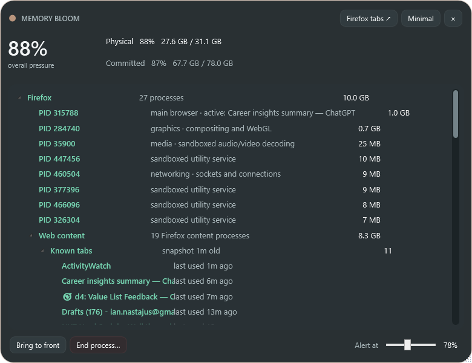

# Memory Bloom 0.3.0 — Firefox metadata and system-memory accounting

- Date: 2026-10-23 10:07 America/Toronto
- Commit: [`d25c7f7`](https://github.com/nastajus/memory-bloom/commit/d25c7f7)
- Release: [`MemoryBloom.exe`](../releases/v0.3.0/MemoryBloom.exe)

## Reported problems

- Firefox tab titles and useful function descriptions were missing.
- Refresh feedback occupied the central content area and obscured text.
- Context menus and the scrollbar conflicted with the dark design.
- Right-clicking needed to select the row being acted upon.
- The physical-memory total exceeded summed process memory with no explanation.
- Tab age/last interaction was requested.

## Implementation

- Decoded Firefox's local `recovery.jsonlz4` session snapshot to obtain titles, URLs, hidden state, and `lastAccessed` timestamps without an extension.
- Added snapshot freshness and active-title mismatch information.
- Classified Firefox processes as main browser, web content, graphics, networking, media, extensions, built-in pages, and utilities.
- Added the estimated **Windows, cache & shared** group, decomposed into file cache, kernel paged/nonpaged pools, and the remaining shared/OS reconciliation amount.
- Moved refresh feedback into a discreet title-area label.
- Added dark context menus, a visible dark scrollbar, row selection on right-click, and explanatory tooltips.

## Challenges and decisions

- Firefox's recovery file is delayed session-recovery data, not a live process API. Titles and ages could be shown, but PID ownership was deliberately not claimed.
- Process working sets overlap because shared pages can appear in several processes. The system-memory group is therefore labeled as an estimate rather than exact ownership.

## Visual evidence

- [Detailed accounting](../screenshots/v0.3.0/detailed.png)
- [Compact view](../screenshots/v0.3.0/minimal.png)

## Next state

Associate titles with Firefox content processes probabilistically, keep unresolved titles explicit, and improve nested layout.
