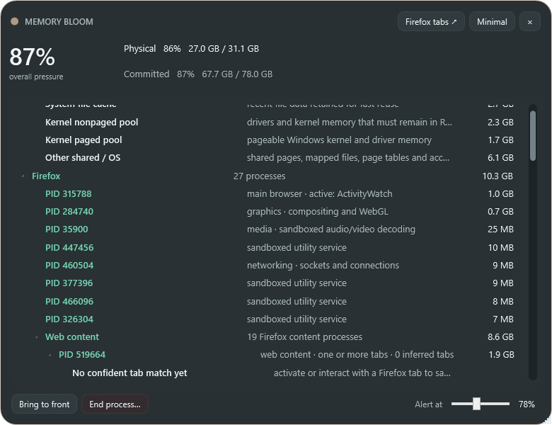
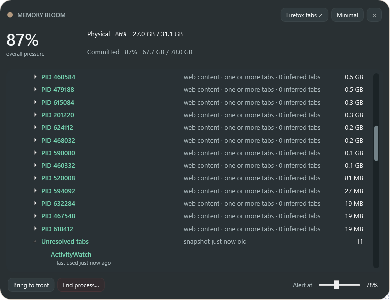

# Memory Bloom 0.4.0 — per-process Firefox tabs and visual audit workflow

- Date: 2026-10-23 10:22 America/Toronto
- Commit: [`8585d37`](https://github.com/nastajus/memory-bloom/commit/8585d37)
- Release: [`MemoryBloom.exe`](../releases/v0.4.0/MemoryBloom.exe)

## Reported problems

- Known tabs were segregated into one list instead of appearing beneath their likely Firefox host process.
- A tab that moved between processes needed to be marked stale or changed rather than presented as certain.
- Last-access metadata indentation cropped titles too early.
- Memory values and **Windows, cache & shared** alignment needed a consistent edge without disappearing beneath the scrollbar.
- Every future feature/design change needed screenshots, a markdown audit, a release snapshot, a commit, and a push.

## Implementation

- Added conservative title-to-PID inference from foreground-title changes plus CPU and working-set deltas.
- Nested confident tab titles beneath inferred Firefox content PIDs and retained an explicit **Unresolved tabs** section.
- Added confidence, observation age, prior PID, drift time, and yellow warnings for uncertain or changed mappings.
- Gave tab titles a full-width first line and moved status/age to an indented second line.
- Reworked row grids so hierarchy is visible while values remain clear of the scrollbar.
- Introduced versioned `docs/screenshots/`, `docs/releases/`, history, and per-prompt Git workflow.

## Challenge and decision

Foreground activity can support an inference but cannot prove ownership. Memory Bloom therefore exposes uncertainty instead of converting a correlation into an authoritative claim.

## Visual evidence

- [Detailed view](../screenshots/v0.4.0/detailed.png)
- [Firefox processes](../screenshots/v0.4.0/firefox-processes.png)
- [Firefox tabs](../screenshots/v0.4.0/firefox-tabs.png)
- [Compact view](../screenshots/v0.4.0/minimal.png)

## Next state

Improve native Windows behavior, reduce inference latency, add branding/desktop integration, and restore stronger hierarchy cues.
