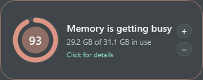

# Memory Bloom 0.5.0 — native Windows integration and faster evidence

- Date: 2026-10-23 10:46 America/Toronto
- Commit: [`34615df`](https://github.com/nastajus/memory-bloom/commit/34615df)
- Release: [`MemoryBloom.exe`](../releases/v0.5.0/MemoryBloom.exe)

## Reported problems

- Custom dragging did not trigger Windows' normal top-edge Snap/maximize preview.
- Firefox title/PID matches could take more than a minute and frequently fell into Unresolved.
- Memory Bloom needed an Alt+Tab icon, a desktop shortcut, and visibility across virtual desktops.
- Parent/child memory values had lost the preferred stepped hierarchy.
- The GitHub repository needed a clear landing page with current screenshots.

## Implementation

- Replaced coordinate dragging with the native non-client move loop and enabled normal resize/maximize styles.
- Added the Memory Bloom multi-resolution icon to the executable, window, tray, and Alt+Tab representation.
- Added desktop-shortcut/startup installation and best-effort Windows shell pinning across virtual desktops.
- Added live foreground Firefox title observation plus a detailed-view-only 500 ms rolling activity sampler.
- Accumulated and decayed CPU/working-set evidence across samples instead of relying on one heavy refresh.
- Restored stepped memory-value indentation and rebuilt the initial GitHub README.

## Challenges and decisions

- The shell's virtual-desktop pinning interface is internal, so failure is non-fatal and documented as best effort.
- A custom WPF drag loop cannot provide the exact operating-system Snap experience. Handing the gesture to Windows solved the behavioral mismatch.
- Faster sampling reduces latency but cannot make a quiet tab distinguishable from a spare pooled process.

## Visual evidence

- [Detailed view](../screenshots/v0.5.0/detailed.png)
- [Firefox processes](../screenshots/v0.5.0/firefox-processes.png)
- [Firefox tabs](../screenshots/v0.5.0/firefox-tabs.png)
- [Compact view](../screenshots/v0.5.0/minimal.png)
- [Application icon](../screenshots/v0.5.0/icon.png)

## Next state

Clarify what candidate Firefox processes mean, handle browser restarts, improve hover/tooltips, and eliminate opaque square corners.
