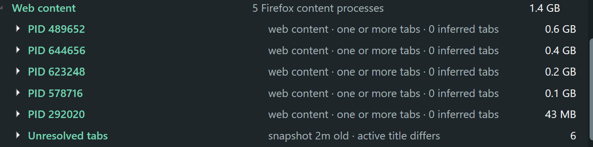

# Memory Bloom 0.6.0 — honest Firefox host status and visual polish

- Date: 2026-10-23 13:42 America/Toronto
- Commit: [`ae17f79`](https://github.com/nastajus/memory-bloom/commit/ae17f79)
- Release: [`MemoryBloom.exe`](../releases/v0.6.0/MemoryBloom.exe)

## Reported problems

- After restarting Firefox with one empty tab, Bloom reported five PIDs with “one or more tabs,” which falsely treated pooled processes as proof of open tabs.
- The meaning of “static” was unclear, and old tab data survived a Firefox restart.
- The entire window needed to become fully opaque on hover.
- Tooltips were clipped.
- Rounded inner content exposed sharp black outer window corners.

## Implementation

- Reworded Firefox rows as candidate tab hosts and displayed observed link counts separately.
- Changed empty candidates to **No tab observed**, explicitly allowing spare, pooled, or indistinguishably quiet processes.
- Included built-in-page processes in sampling and guarded the zero-evidence path.
- Cleared inference state when the Firefox browser PID changed and ignored recovery data predating the current browser session.
- Normalized a bare Firefox title to **New Tab**.
- Made hover temporarily set whole-window opacity to 100%.
- Widened/wrapped tooltips and applied a native rounded window region.

## Challenges and decisions

“Static” was not retained as a UI state because Firefox has no such tab state. It had only meant that a page was too quiet to generate a distinctive signal. Candidate/observed language is more accurate.

The native rounded region removed opaque corners while preserving Windows resize and Snap behavior, but its geometry later exposed a DPI-related second-curve problem addressed in 0.7.0.

## Reported evidence

## Generated evidence

- [Detailed view](../screenshots/v0.6.0/detailed.png)
- [Firefox candidate hosts](../screenshots/v0.6.0/firefox-processes.png)
- [Firefox tabs](../screenshots/v0.6.0/firefox-tabs.png)
- [Compact view](../screenshots/v0.6.0/minimal.png)

## Next state

Resolve competing corner curves, prevent development restarts from stealing focus, expand detailed mode toward available screen space, and expire stale PID confidence.
