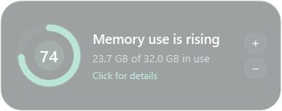
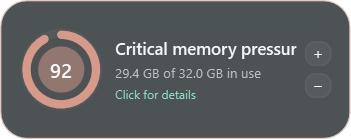

# Memory Bloom 0.9.0 — pressure tiers and diagnostic-first Firefox ordering

- Date: 2026-10-23
- Release: [`MemoryBloom.exe`](../releases/v0.9.0/MemoryBloom.exe)
- Companion: [`MemoryBloom.Companion.xpi`](../releases/v0.9.0/MemoryBloom.Companion.xpi)

## Request and reported problems

- Stage lower-memory screenshots that visibly preserve lower whole-window transparency, capture every meaningful pressure tier, and backfill the evidence to the version where pressure visualization began.
- Add one lower-pressure comparison beside the existing opaque 92% README image.
- List every pressure tagline used by the app.
- **Tab hosts** still appeared at a fixed position beneath ordinary Firefox child PIDs rather than participating in memory order.
- Tab-host PIDs with observed web pages needed a stronger color and symbol cue.
- **Unresolved tabs** needed to move to the top temporarily because it remains the highest-value diagnostic state while unresolved additions are frequent.

## Implementation

- Added four semantic compact taglines:
  - **Memory is comfortable** below the hide threshold.
  - **Memory use is rising** inside the hysteresis band.
  - **Memory is getting busy** at visible alert pressure below 90%.
  - **Critical memory pressure** at 90% and above.
- Added deterministic 55%, 74%, 82%, and 92% staged captures. The normal continuous formula still controls arc, green-to-coral color, pulse, and resting opacity.
- Preserved transparency in the PNG alpha channel rather than faking a lighter background. Approximate panel-center alpha is 38%, 42%, 58%, and 77% respectively; hover remains 100% opaque.
- Placed the Tab hosts aggregate into the same memory-descending sequence as Firefox's individual child processes, using the section's summed private memory as its sort weight.
- Kept tab-host PIDs within their section sorted by private memory descending.
- Moved Unresolved tabs before every candidate PID.
- Marked a host with current inferred web-page links as blue bold `● PID …`; empty and historical-only candidates retain the normal PID treatment.

## Challenges and decisions

- A 55% compact state would normally be hidden, so it is labeled as a staged design reference rather than ordinary runtime visibility.
- WPF's window opacity is applied by desktop composition and is not automatically preserved by a raw visual render. The preview temporarily applies the computed resting opacity to the captured panel so the PNG retains real alpha.
- The aggregate Tab hosts node represents many processes. Sorting it alongside single PIDs by the sum of its children matches what the displayed memory value communicates.
- Blue was chosen for current hosted-page evidence so it cannot be confused with green structural accents or yellow stale/uncertain evidence.

## Visual evidence

- [Detailed ordering](../screenshots/v0.9.0/detailed.png)
- [Firefox process view](../screenshots/v0.9.0/firefox-processes.png)
- [Diagnostic-first unresolved view](../screenshots/v0.9.0/firefox-tabs.png)
- [Current compact state](../screenshots/v0.9.0/minimal.png)
- [Comfortable 55%](../screenshots/v0.9.0/tier-comfortable-55.png)
- [Rising 74%](../screenshots/v0.9.0/tier-rising-74.png)
- [Busy 82%](../screenshots/v0.9.0/tier-busy-82.png)
- [Critical 92%](../screenshots/v0.9.0/tier-critical-92.png)

| Comfortable · 55% | Rising · 74% |
|---|---|
|  |  |

| Busy · 82% | Critical · 92% |
|---|---|
|  |  |

## Next state

Validate the blue current-host treatment with live companion evidence, reduce the unresolved rate, and return Unresolved tabs to the bottom once it becomes exceptional rather than diagnostic-first.
